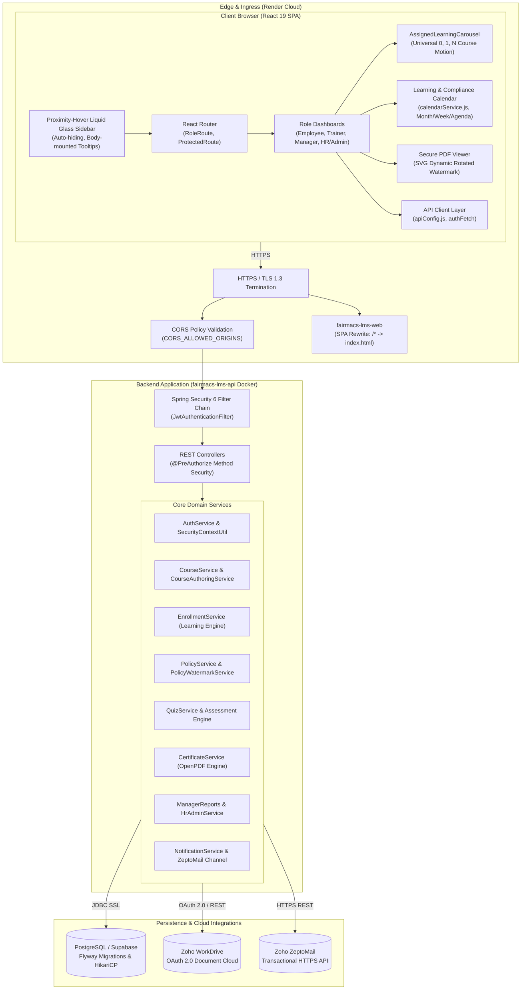

# Fairmacs KMS — Technical Architecture Blueprint

**Application:** Fairmacs Knowledge Management System (KMS)  
**Classification:** Enterprise System Architecture Specification  
**Architecture Style:** Layered Single-Page Application (SPA) + Spring Boot Cloud REST API  
**Core Stack:** React 19, Vite 8, Spring Boot 3.2.0, PostgreSQL (Supabase Cloud), Docker, Render Cloud

---

## 📑 Table of Contents
1. [Architectural Overview & System Context](#1-architectural-overview--system-context)
2. [End-to-End System Architecture (Mermaid)](#2-end-to-end-system-architecture-mermaid)
3. [Frontend Architecture (React 19 & Vite 8)](#3-frontend-architecture-react-19--vite-8)
   - [3.1 Proximity-Hover Intelligent Liquid Glass Sidebar](#31-proximity-hover-intelligent-liquid-glass-sidebar)
   - [3.2 Universal Assigned Learning Carousel](#32-universal-assigned-learning-carousel)
   - [3.3 Learning & Compliance Calendar Architecture](#33-learning--compliance-calendar-architecture)
   - [3.4 Course Builder 5-Step Curriculum Wizard](#34-course-builder-5-step-curriculum-wizard)
   - [3.5 Secure Watermarked In-Browser PDF Viewer](#35-secure-watermarked-in-browser-pdf-viewer)
4. [Backend Service Layer (Spring Boot 3.2.0)](#4-backend-service-layer-spring-boot-320)
   - [4.1 Security Filter Chain & RBAC Subsystem](#41-security-filter-chain--rbac-subsystem)
   - [4.2 Corporate Policies & SOP Agreements Subsystem](#42-corporate-policies--sop-agreements-subsystem)
   - [4.3 Dynamic Rotated Non-Clipping Watermarking](#43-dynamic-rotated-non-clipping-watermarking)
   - [4.4 Assessment & Credential Engine](#44-assessment--credential-engine)
   - [4.5 Transactional Notifications (Zoho ZeptoMail)](#45-transactional-notifications-zoho-zeptomail)
5. [Data Architecture & Persistence (PostgreSQL / Flyway)](#5-data-architecture--persistence-postgresql--flyway)
6. [Containerization & Render Cloud Deployment](#6-containerization--render-cloud-deployment)
7. [Automated Verification & Test Harness](#7-automated-verification--test-harness)

---

## 1. Architectural Overview & System Context

Fairmacs KMS is designed for an international shipping, logistics, and freight forwarding enterprise with 500+ employees. The platform balances high operational security with an intuitive, calm, editorial user interface.

### Key Architectural Tenets:
- **Zero-Credential-in-Code:** All credentials, database connection strings, JWT secrets, and API tokens are dynamically provided through environment variables.
- **Defense in Depth:** Multi-layered authorization: edge TLS termination, CORS origin validation, JWT authentication filters, Spring Security method-level annotations (`@PreAuthorize`), and database-level relational constraints.
- **Role-Based Workspace Scoping:** UI and API contracts strictly segregate 5 roles: `EMPLOYEE`, `TRAINER`, `MANAGER`, `HR_ADMIN`, and `SUPER_ADMIN`.
- **Fault-Tolerant Integrations:** Third-party cloud systems (Zoho WorkDrive, Zoho ZeptoMail) are decoupled via async workers and feature toggles, ensuring zero downtime if external cloud providers experience outages.

---

## 2. End-to-End System Architecture (Mermaid)



---

## 3. Frontend Architecture (React 19 & Vite 8)

The frontend is built on **React 19** with **Vite 8**, prioritizing responsive data presentation, fluid transitions, and accessibility.

### 3.1 Proximity-Hover Intelligent Liquid Glass Sidebar (`Sidebar.jsx`)
- **Proximity Edge Activation:** Detects pointer proximity within 8–16px of the left screen boundary to smoothly expand from a slim visual rail into the navigation dock.
- **Liquid Glass Aesthetic:** Uses backdrop blur (`28px`), semi-transparent ice-white surfaces (`rgba(255, 255, 255, 0.45)`), and specular reflections.
- **Body-Mounted Floating Tooltip Portal:** Mounts tooltips directly to `document.body` via `createPortal`, guaranteeing zero visual clipping from parent container overflow or stacking contexts.
- **9 Dedicated HR Navigation Routes:** Eliminates monolithic tab switching in favor of clean URLs (`/hr/overview`, `/hr/courses`, `/hr/employees`, `/hr/departments`, `/hr/policies`, `/hr/announcements`, `/hr/credentials`, `/hr/drafts`, `/hr/settings`).
- **Profile & Logout Actions:** Bottom docked actions with direct routing to `/profile` and explicit session termination.

### 3.2 Universal Assigned Learning Carousel (`AssignedLearningCarousel.jsx`)
- Shared component across **Employee**, **Manager**, and **HR/Admin** dashboards.
- Populated exclusively with courses assigned to the authenticated user.
- Responsive pagination handling 0 (empty glass card), 1 (single card centered), and N cards without awkward whitespace or broken sliding.
- Supports keyboard navigation (`ArrowLeft` / `ArrowRight`) and respects `prefers-reduced-motion`.

### 3.3 Learning & Compliance Calendar Architecture (`calendarService.js`, `UpcomingTrainingWidget.jsx`)
- **Unified Aggregation:** Consolidates live training sessions, course due dates, policy deadlines, and quizzes into normalized calendar events.
- **Strict Policy Due Date Rule:** Policies without an explicit due date (`dueDate === null`) are never stamped as overdue tasks.
- **Compact Widget Integration:** Embedded directly into Employee, Manager, and HR/Admin dashboards for instant deadline awareness.

### 3.4 Course Builder 5-Step Curriculum Wizard (`CourseBuilderModal.jsx`)
- Structured authoring wizard:
  1. *Course Details* (Code, title, category, level, estimated duration).
  2. *Syllabus & Modules* (Hierarchical module and lesson creation).
  3. *Assessments* (Integrated quiz questions, passing thresholds).
  4. *Target Departments* (Divisional assignment configuration).
  5. *Review & Publish* (Validation check and instant publication).

### 3.5 Secure Watermarked In-Browser PDF Viewer (`PolicyPdfViewerModal.jsx`, `CourseViewer.jsx`)
- Uses `pdfjs-dist` to render PDF streams on HTML canvas.
- Stamps an SVG overlay across the viewport containing:
  `PROPERTY OF FAIRMACS SHIPPING & LOGISTICS — CONFIDENTIAL — <EMPLOYEE_NAME> — <TIMESTAMP>`
- Non-clipping rotation and pointer-events pass-through preserve native scrolling and inspection while protecting intellectual property.

---

## 4. Backend Service Layer (Spring Boot 3.2.0)

### 4.1 Security Filter Chain & RBAC Subsystem
- Stateless architecture: Every request passes through `JwtAuthenticationFilter`, extracting the Bearer token and populating the Spring `SecurityContext`.
- Role verification using standard Spring authorities: `ROLE_EMPLOYEE`, `ROLE_TRAINER`, `ROLE_MANAGER`, `ROLE_HR_ADMIN`, `ROLE_SUPER_ADMIN`.
- Account status guard: Inactive or terminated users are blocked at the filter level regardless of token expiration.

### 4.2 Corporate Policies & SOP Agreements Subsystem (`PolicyService.java`)
- **Targeting Engine:** Matches policies to employees via company-wide, department hierarchy, or individual assignment rules.
- **Audit Trails:** Acknowledgements produce immutable records storing signature strings, timestamps, and IP addresses.
- **Manager Oversight:** Scopes compliance monitoring strictly to the manager's authorized department hierarchy.

### 4.3 Dynamic Rotated Non-Clipping Watermarking (`PolicyWatermarkService.java`)
- Stamped on PDF streams dynamically generated via OpenPDF.
- Calculates document dimensions (Letter/A4, portrait/landscape) to ensure watermark lines remain strictly inside printable margins.

### 4.4 Assessment & Credential Engine (`QuizService.java`, `CertificateService.java`)
- Automated grading against an 80% passing standard.
- Verified certificate generation assigning formatted IDs (`CERT-OP-2026-XXXX`).
- Public verification endpoint (`/api/certificates/verify/{certNumber}`) allows external audits of employee qualifications.

### 4.5 Transactional Notifications (Zoho ZeptoMail)
- Decoupled `NotificationChannel` interface.
- When enabled via `NOTIFICATION_EMAIL_ENABLED=true`, sends transactional emails via ZeptoMail REST API (`https://api.zeptomail.in/v1.1/email`).
- Fallback in-app notifications are persisted in PostgreSQL and delivered immediately.

---

## 5. Data Architecture & Persistence (PostgreSQL / Flyway)

- **PostgreSQL (Supabase Cloud):** Multi-region relational database with connection pooling and SSL encryption in transit (`sslmode=require`).
- **Flyway Database Migrations:** Versioned SQL migrations (`src/main/resources/db/migration/`) maintain schema parity across local development, staging, and production.
- **Key Tables:**
  - `users`: Core workforce identity and role metadata.
  - `departments`: Operational divisions and hierarchy.
  - `courses`, `modules`, `lessons`: Curriculum structure.
  - `enrollments`, `lesson_progress`: Learner progress tracking.
  - `quizzes`, `quiz_questions`, `quiz_progress`: Assessment engine.
  - `certificates`: Issued qualifications and digital seals.
  - `policy_documents`, `policy_versions`, `policy_assignments`: Compliance governance.
  - `notifications`: In-app notification center records.

---

## 6. Containerization & Render Cloud Deployment

Fairmacs KMS deploys via Render Blueprint (`render.yaml`) combining two services:

### 6.1 Backend Web Service (`fairmacs-lms-api`)
- Built from `backend/Dockerfile`.
- Runtime environment: Docker on Linux.
- Memory profile: Optimized for 512 MB instances (`-XX:MaxRAMPercentage=70 -XX:+UseSerialGC -Xss512k`).
- Dynamic port resolution: Spring Boot listens on `${PORT:8080}` as assigned by the host.
- Secrets managed safely in the Render dashboard (`sync: false`).

### 6.2 Frontend Static Site (`fairmacs-lms-web`)
- Runtime environment: Static web service running Node 22.
- Build command: `npm ci && npm run build`.
- Publish directory: `frontend/dist`.
- Route rewrite rule: `/*` -> `/index.html` (supporting React Router `BrowserRouter`).

---

## 7. Automated Verification & Test Harness

The system is validated by an automated test harness covering both frontend and backend:

- **Frontend Suites:** 23 Node.js verification suites checking UI components, portals, responsive behaviors, accessibility, and routing.
  ```bash
  npm --prefix frontend test
  ```
- **Frontend Production Build:** Vite 8 production bundling with Rolldown tree-shaking and gzip compression checks.
  ```bash
  npm --prefix frontend run build
  ```
- **Backend Test Suites:** Spring Boot unit, slice, and integration tests verifying security filters, database rollups, and policy compliance.
  ```bash
  mvn -f backend/pom.xml test
  ```
