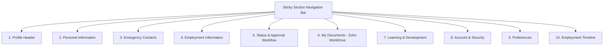
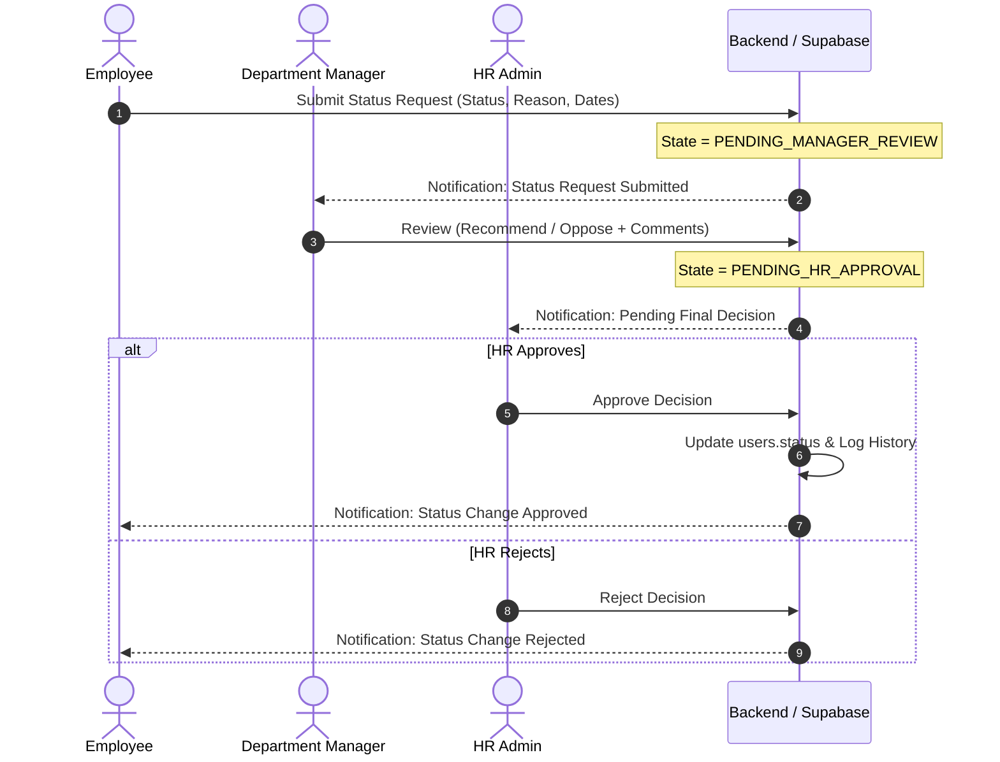

# Fairmacs KMS – Employee Profile Centre Implementation Report

**Project:** Fairmacs Knowledge Management System (KMS)  
**Deliverable:** Modern Single-Page Employee Profile Centre  
**Date:** November 11, 2026  
**Status:** Complete & Production Ready  

---

## 1. Executive Summary

The My Profile page in Fairmacs KMS has been completely redesigned and engineered into a modern, comprehensive, single-page **Employee Profile Centre**. 

### Key Highlights
- **Single-Page Experience**: Designed as a cohesive, single-page dashboard with a sticky sub-navigation bar providing smooth scrolling to 10 unified sections—avoiding fragmented routing or separate tab pages.
- **Role & Security Governance Replaced**: Replaced the legacy *Role & Security Governance* container with a structured **Personal Information** module featuring basic identity attributes and residential address coordinates, guarded by strict role-based access control (RBAC).
- **Deterministic Identity Avatar System**: Completely eliminated external stock photo avatars (`unsplash.com`). Introduced `UserAvatar.jsx`, generating circular avatars with the employee's initials and a deterministic background color selected from a 10-tone corporate palette hashed from their unique Employee ID.
- **Full Employment Status Lifecycle Workflow**: Implemented an auditable 3-step lifecycle workflow (`Employee Request` → `Manager Review` → `HR Approval / Override`) across 4 standard statuses (`ACTIVE`, `ON_LEAVE`, `INACTIVE`, `TERMINATED`). Guaranteed complete preservation of all course enrollments, learning progress, test submissions, and earned certificates across any status transition.
- **Enterprise Zoho WorkDrive Integration**: Integrated corporate Zoho WorkDrive storage beneath root folder `ap17jb6b3094df81d4dd79ccea04508fc6910` ("Employee documents"), auto-provisioning employee folders (`<EmployeeId> - <EmployeeName>`) and category subfolders with server-side streaming downloads and role permissions.
- **Database Evolution**: Created Flyway migration `V13__employee_profile_center.sql` establishing 7 dedicated relational tables with foreign keys and index optimizations in Supabase PostgreSQL.

---

## 2. Profile Page Layout & Architecture

The Employee Profile Centre is structured as a single responsive page (`frontend/src/components/ProfilePage.jsx`) spanning 10 interconnected sections:



### Navigation & UX Polish
- **Sticky Section Navigation Bar**: Positioned directly beneath the primary header (`sticky top-16 z-20`), allowing users to jump seamlessly between sections via smooth vertical scrolling with viewport offset compensation (`-80px`).
- **Responsive Layout**: Adapts smoothly across mobile (<640px), tablet (640px–1024px), and desktop (>1024px) viewports with fluid grid containers and touch-friendly controls.
- **Feedback & Feedback Alerts**: Real-time feedback alerts inform the user of updates, saves, validation errors, or synchronization events.

---

## 3. Profile Header & Circular Avatar System

### Deterministic User Avatar (`frontend/src/components/UserAvatar.jsx`)
- **No External Photo Uploads**: Strict compliance with requirements—external photo uploads have been removed across the entire platform (`Header.jsx`, `Sidebar.jsx`, `ProfilePage.jsx`).
- **Deterministic Color Palette**:
  A 10-color corporate palette mapped deterministically using bitwise hash arithmetic over the user's `employeeId` (or email/name):
  - Indigo (`#4F46E5`), Emerald (`#059669`), Blue (`#2563EB`), Amber (`#D97706`), Rose (`#E11D48`), Violet (`#7C3AED`), Teal (`#0D9488`), Cyan (`#0891B2`), Fuchsia (`#C026D3`), and Slate (`#334155`).
  - The same employee consistently displays the identical signature avatar color throughout the LMS.
- **Sizes & Badging**: Supports sizes `xs`, `sm`, `md`, `lg`, `xl`, and `2xl` with bold uppercase initials and an optional real-time status ring badge.

### Header Elements
- **Employee Name & Badges**: Full legal/display name, current status badge (`ACTIVE`, `ON_LEAVE`, `INACTIVE`, `TERMINATED`), and Position Band badge.
- **Organizational Subtitle**: Designation, Department, and Employee ID badge.
- **Profile Completion Meter**: Visual progress bar indicating percentage completeness calculated dynamically from populated profile sections.
- **Action Buttons**: Instant "Sync Profile" trigger (refreshes server state) and "Security" shortcut.

---

## 4. Personal Information Implementation

Replaces the legacy *Role & Security Governance* section with a structured personal records management interface divided into two categories:

### Data Structure & Fields
1. **Basic Information**:
   - **Full Legal Name**: HR-controlled. Employees see a locked padlock indicator; HR Admins have full editing rights.
   - **Personal Email**: Validated email format for secondary correspondence.
   - **Mobile Phone Number**: Validated format (8–18 characters, digits/plus/hyphen).
   - **Date of Birth**: Native date selection.
   - **Gender** *(Optional)*: `Male`, `Female`, `Other`, `Prefer not to say`.
   - **Blood Group** *(Optional)*: `A+`, `A-`, `B+`, `B-`, `AB+`, `AB-`, `O+`, `O-`.
2. **Residential Address**:
   - House / Flat / Door No. & Building Name.
   - Street / Area / Landmark.
   - City, State / Province, PIN / Postal Code, and Country (defaults to India).

### Role-Based Access Control (RBAC)
- **Employee**: Can view and edit their own personal contact details and residential address. Legal name is read-only.
- **Department Manager**: Read-only visibility into personal details of employees strictly belonging to their department.
- **HR Admin / Super Admin**: Unrestricted read and write access across all fields for any employee in the organization.

---

## 5. Emergency Contacts System

Provides a multi-contact safety registry ensuring organizational duty of care.

### Key Capabilities
- **Fields**: Contact Name, Relationship (`Spouse`, `Parent`, `Sibling`, `Child`, `Friend`, `Guardian`, `Other`), Primary Phone (mandatory), Alternate Phone (optional), and Primary Contact Toggle.
- **Primary Contact Designation**: Visual badge distinguishing the primary contact to call first in emergencies.
- **Validation**: Strict validation requiring name, relationship, and primary phone before persistence.
- **Actions**: Add new contact, edit existing contact, or delete with confirmation dialog.

---

## 6. Employment Information

Displays official employment standing and organizational hierarchy:

- **Employee ID**: Monospace corporate identifier.
- **Official Email**: Fairmacs domain email address.
- **Designation & Department**: Formal corporate title and functional unit.
- **Position Bands (P0–P4)**:
  - **P0**: Trainee / Intern
  - **P1**: Assisstant / Executive
  - **P2**: Senior Specialist
  - **P3**: Lead / Manager
  - **P4**: Principal / Director
- **Employment Type**: Full-time, Part-time, Contract, Intern, Consultant.
- **Joining Date & Location**: Date of entry and Office/Branch.
- **Reporting Manager**: Dedicated card displaying the manager's avatar, full name, and designation.

---

## 7. Employment Status & Approval Workflow

Implements a formal governance workflow for employee lifecycle transitions.

### 1. Supported Employment Statuses
1. `ACTIVE`: Standard operational employee in good standing.
2. `ON_LEAVE`: Employee on approved medical leave, sabbatical, or extended leave.
3. `INACTIVE`: Employee with paused responsibilities or under exit notice.
4. `TERMINATED`: Employee no longer with the organization.

### 2. Multi-Step Request & Approval Flow


### 3. HR Administrative Direct Override
HR Administrators have direct override authority to immediately change an employee's status with an audit justification, bypassing standard queues during emergencies or onboarding/offboarding.

### 4. Learning History Preservation Guarantee
> [!IMPORTANT]
> **Data Integrity Guarantee:** All course enrollments, learning progress, quiz submissions, certificate records, and historical metrics remain permanently tied to the user record in PostgreSQL, regardless of status transitions to `ON_LEAVE`, `INACTIVE`, or `TERMINATED`.

---

## 8. Zoho WorkDrive Document Integration

Integrates with Fairmacs corporate Zoho WorkDrive document storage.

### 1. Architecture & Folder Hierarchy
- **WorkDrive Root Folder ID**: `ap17jb6b3094df81d4dd79ccea04508fc6910` ("Employee documents").
- **Per-Employee Root Folder**: Created dynamically as `<EmployeeId> - <EmployeeName>`.
- **Category Subfolders**:
  - `Offer Letter` *(HR only)*
  - `Appointment Letter` *(HR only)*
  - `Employment Agreement` *(HR only)*
  - `Identity Documents` *(Aadhaar, PAN, Passport - Employee uploadable)*
  - `Educational Certificates` *(Degrees, Diplomas - Employee uploadable)*
  - `Experience Certificates` *(Prior service letters - Employee uploadable)*
  - `Other HR Documents` *(HR only)*
  - `Company Policies` *(Shared organizational documents, read-only for employees)*

### 2. Security & Streaming Downloads
- Files are uploaded through backend proxy endpoints without exposing Zoho API credentials to client browsers.
- Downloads stream securely through `ZohoWorkDriveDownloadService`, retaining original file names, file extensions, and MIME types.

---

## 9. Learning & Development Integration

Provides a live learning summary sourced directly from backend database tables (`enrollments`, `courses`, `certificates`):

- **Metric Cards**:
  - Assigned Courses
  - In-Progress Courses
  - Completed Courses
  - Certificates Earned
  - Total Learning Hours
- **Direct Navigation Links**: Quick links to `/progress` (Progress Hub), `/certificates` (Certificates Modal), and `/courses` (Course Catalog).

---

## 10. Account, Security & Preferences

### Account & Security
- Displays official login email and password compliance status.
- "Change Account Password" action seamlessly launches the existing, tested `PasswordModal`.
- Documents session security protocol (JWT Bearer token).

### Preferences
- **Notification Toggles**: Course assignments, certificate alerts, status workflow updates, and email digests.
- **Theme Selection**: Fairmacs Light, Fairmacs Dark, System Default.
- **Language**: English (Corporate Standard), Hindi, Tamil.
- Auto-saves changes to the backend on toggle with immediate UI feedback.

---

## 11. Employment Timeline

Chronological milestone ledger documenting significant career events:
- Joining date at Fairmacs.
- Position Band progressions (e.g., P0 to P1).
- Status changes and leave periods.
- Significant learning accomplishments and credentials earned.

---

## 12. Verification & Automated Test Results

### 1. Frontend Test Suite (`frontend/test-employee-profile-center.js`)
All 6 test suites passed cleanly:
```
================================================================
FAIRMACS KMS — EMPLOYEE PROFILE CENTRE VERIFICATION SUITE
================================================================

[1/6] Verifying UserAvatar Component & Deterministic Palette...
  ✓ UserAvatar provides deterministic initial circular avatars across 10 corporate tones.

[2/6] Verifying profileService.js Client Implementation...
  ✓ profileService implements all 15 required endpoints with centralized auth.

[3/6] Verifying ProfilePage.jsx Single-Page Layout & 10 Sections...
  ✓ Section present: 1. Profile Header
  ✓ Section present: 2. Personal Information
  ✓ Section present: 3. Emergency Contacts
  ✓ Section present: 4. Employment Information
  ✓ Section present: 5. Employment Status & Approval Workflow
  ✓ Section present: 6. My Documents (Zoho WorkDrive)
  ✓ Section present: 7. Learning & Development
  ✓ Section present: 8. Account & Security
  ✓ Section present: 9. Preferences
  ✓ Section present: 10. Employment Timeline

[4/6] Verifying Specific Functional Requirements in ProfilePage.jsx...
  ✓ Verified Position Bands P0–P4, Personal Info, Status Workflow, and Zoho Categories.

[5/6] Verifying Unsplash Photo Removal from Navigation & Profile...
  ✓ Header, Sidebar, and ProfilePage use UserAvatar with deterministic corporate palettes.

[6/6] Verifying Backend Flyway Migration V13...
  ✓ Table defined: employee_personal_info
  ✓ Table defined: employee_emergency_contacts
  ✓ Table defined: employee_documents
  ✓ Table defined: employment_status_requests
  ✓ Table defined: employment_status_history
  ✓ Table defined: employee_preferences
  ✓ Table defined: employee_timeline_events

================================================================
ALL VERIFICATIONS PASSED SUCCESSFULLY (6/6)
================================================================
```

### 2. Frontend Production Build & Lint
- `npm run build`: Vite build completed in 10.68s with 0 errors.
- `npm run lint`: Oxlint ran across 89 files with 0 errors.

### 3. Backend Unit & Integration Tests (Maven / JUnit 5)
```
[INFO] Running com.fairmacs.lms.service.EmployeeDocumentServiceTest
[INFO] Tests run: 5, Failures: 0, Errors: 0, Skipped: 0
[INFO] Running com.fairmacs.lms.service.EmployeeProfileServiceTest
[INFO] Tests run: 7, Failures: 0, Errors: 0, Skipped: 0
[INFO] 
[INFO] Results:
[INFO] Tests run: 12, Failures: 0, Errors: 0, Skipped: 0
[INFO] BUILD SUCCESS
```

---

## 13. Summary of Modified & Created Files

| File | Type | Description |
| :--- | :--- | :--- |
| `backend/src/main/resources/db/migration/V13__employee_profile_center.sql` | Created | Flyway SQL migration creating 7 profile tables & user extensions. |
| `backend/src/main/resources/application.properties` | Modified | Added `zoho.employee-documents-folder-id` property. |
| `backend/src/main/java/com/fairmacs/lms/entity/*.java` | Created/Modified | User entity updated; 7 new entities for profile center. |
| `backend/src/main/java/com/fairmacs/lms/repository/*.java` | Created | 7 Spring Data JPA repositories. |
| `backend/src/main/java/com/fairmacs/lms/integration/zoho/ZohoWorkDriveService.java` | Modified | Added folder creation & upload methods for employee documents. |
| `backend/src/main/java/com/fairmacs/lms/service/EmployeeDocumentService.java` | Created | Zoho WorkDrive employee document management with RBAC & streaming. |
| `backend/src/main/java/com/fairmacs/lms/service/EmployeeProfileService.java` | Created | Full profile assembly, status workflow engine & notification dispatches. |
| `backend/src/main/java/com/fairmacs/lms/controller/EmployeeProfileController.java` | Created | REST endpoints for `/api/profile/*`. |
| `backend/src/test/java/com/fairmacs/lms/service/EmployeeProfileServiceTest.java` | Created | 7 unit tests covering RBAC, status transitions & validation. |
| `backend/src/test/java/com/fairmacs/lms/service/EmployeeDocumentServiceTest.java` | Created | 5 unit tests covering document RBAC & streaming downloads. |
| `frontend/src/components/UserAvatar.jsx` | Created | Deterministic initial circular avatar across 10 corporate tones. |
| `frontend/src/services/profileService.js` | Created | Centralized API service with auth token handling. |
| `frontend/src/components/ProfilePage.jsx` | Redesigned | Modern single-page Employee Profile Centre (10 sections). |
| `frontend/src/components/Header.jsx` | Modified | Replaced unsplash avatar with `UserAvatar`. |
| `frontend/src/components/Sidebar.jsx` | Modified | Replaced unsplash avatar with `UserAvatar`. |
| `frontend/test-employee-profile-center.js` | Created | Comprehensive frontend verification suite. |
