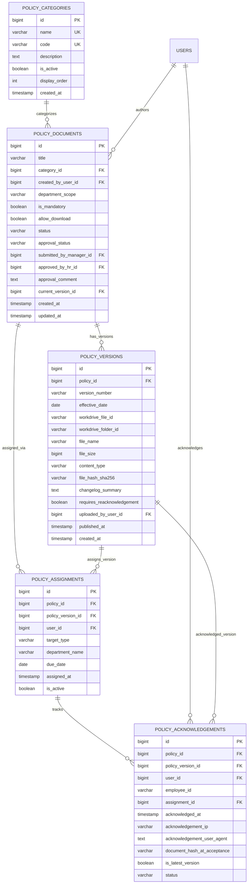

# Fairmacs KMS — Policies & Agreements Management System
## Stage 1: Existing System Audit & Integration Architecture Report (Finalized)

**Document Name:** `Policies_Agreements_Stage_1_Audit_Report.md`  
**System:** Fairmacs Knowledge Management System (KMS)  
**Audit Stage:** Stage 1 — Existing System Audit & Architecture  
**Audit Type:** Comprehensive Read-Only Audit & Architectural Integration Design  
**Revision:** Finalized with Confirmed Business Decisions & Technical Clarifications  
**Status:** COMPLETE — Awaiting Explicit Approval Before Stage 2  

---

## 1. Executive Summary

### 1.1 Objective & Context
The Fairmacs Knowledge Management System (KMS) currently provides Course Management, Employee Learning, Assessments, Certifications, Training Analytics, and an Employee Profile Centre. This audit establishes the architectural foundation for integrating an enterprise-grade **Policies & Agreements Management System** into the existing production architecture.

The system will enable:
1. **Employees:** Access, view, and explicitly acknowledge organizational and department-specific policies and agreements from **My Profile → Policies & Agreements** (completely replacing the previous static "My Documents" section).
2. **HR/Admin:** Centrally manage the policy lifecycle—document authoring/uploading, multi-versioning, targeted audience assignment (organization-wide, department, or individual), optional acknowledgement due dates, review and approval of manager submissions, and real-time compliance reporting.
3. **Department Managers:** Upload department-specific SOPs and guidelines, submit them to HR/Admin for approval, and track employee compliance exclusively within their authorized departmental hierarchy.
4. **Trainer Role Scope:** Trainers receive no administrative or management permissions for Policies & Agreements. Standard employee-level access applies when a policy is assigned to them.

### 1.2 Confirmed Business Decisions & Principles
* **Read-Only Audit:** No source code, database tables, Flyway migrations, or Zoho WorkDrive folders were modified or created.
* **Personal Employee Documents Scope Boundary:**
  * The existing "My Documents" section is completely removed from the employee-facing Profile Centre and replaced with Policies & Agreements.
  * No "Personal Records" tab will be created. Personal documents (identity cards, educational certificates, offer letters, appointment letters, etc.) are excluded from this feature.
  * The scope of this project is strictly confined to Policies & Agreements; it does not expand into personal employee document management.
  * Existing data in `employee_documents` is retained non-destructively for administrative continuity.
* **Acknowledgement Due Dates (Optional & Open-Ended):**
  * Due dates are strictly optional. HR/Admin can specify a due date during publication or leave it open-ended.
  * No automatic 14-day or other default deadline will be assigned.
  * Policies without due dates will never generate approaching deadline or overdue reminder notifications.
  * Pending acknowledgement status remains visible to both employees and management regardless of whether a due date exists.
* **Non-Disruptive Portal Experience & Notification Rules:**
  * No mandatory popups upon login; portal access is never blocked.
  * Existing KMS in-app notification engine informs employees of pending policies and directs them to `My Profile → Policies & Agreements`.
  * Dismissing or marking a notification as read never counts as document acceptance.
  * Only explicit user acknowledgement (checkbox + Accept & Continue) creates an acceptance record.
* **Separation of Concerns & Immutability:**
  * Policies and agreements are isolated in dedicated relational tables (`policy_documents`, `policy_versions`, `policy_assignments`, `policy_acknowledgements`, `policy_categories`).
  * Acceptance records in `policy_acknowledgements` are strictly append-only (insert-only) and immutable; prior version histories are never updated or overwritten.

### 1.3 System Audit Matrix & Verification Statuses

The following statuses are strictly applied based on verified evidence:
* **Verified implementation:** Tested and functioning in running code or automated tests.
* **Found in source code but not runtime-tested:** Located and analyzed in repository files/configuration, but not dynamically validated in live production during this read-only audit.
* **Not implemented:** Required capability that does not yet exist in the KMS codebase.
* **Unable to verify:** Cannot be definitively confirmed without live remote calls or write operations.

| Dimension | Audit Status | Evidence / Location | Assessment for Policies & Agreements |
| :--- | :--- | :--- | :--- |
| **Frontend Framework** | Verified implementation | React 18, Vite 5, Tailwind CSS, Lucide icons | High readiness; layout and modal patterns are reusable |
| **Profile Centre UI** | Verified implementation | [`frontend/src/components/ProfilePage.jsx`](file:///r:/lms/frontend/src/components/ProfilePage.jsx) | Clean 7-section layout; Section 5 (`#my-documents`) is the confirmed replacement target |
| **PDF Canvas Rendering** | Verified implementation | `pdfjs-dist` in [`CourseViewer.jsx`](file:///r:/lms/frontend/src/components/CourseViewer.jsx#L966-L1070) | Controlled presentation rendering; removes native browser PDF toolbars. **Note:** Cannot prevent OS-level screenshots or client screen captures |
| **PDF Watermarking** | Not implemented *(Library present)* | `openpdf` (5.x) in [`backend/pom.xml`](file:///r:/lms/backend/pom.xml), used in `CertificateService.java` | Planned functionality. Server-side `PdfStamper` dynamic employee watermarking to be implemented in Stage 6 |
| **Zoho WorkDrive Config** | Found in source code but not runtime-tested | [`ZohoWorkDriveService.java`](file:///r:/lms/backend/src/main/java/com/fairmacs/lms/integration/zoho/ZohoWorkDriveService.java), `application.properties` | Root folder `ap17jb6b3094df81d4dd79ccea04508fc6910` confirmed in code/config. Remote policy folder provisioning unverified |
| **Notification Engine** | Verified implementation | [`NotificationService.java`](file:///r:/lms/backend/src/main/java/com/fairmacs/lms/service/NotificationService.java), [`NotificationSchedulerService.java`](file:///r:/lms/backend/src/main/java/com/fairmacs/lms/service/NotificationSchedulerService.java) | In-app alerts, dedup keys, action URLs, and daily cron (08:00 AM) ready for policy events |
| **Role & Permissions** | Verified implementation | [`SecurityConfig.java`](file:///r:/lms/backend/src/main/java/com/fairmacs/lms/security/SecurityConfig.java), [`SecurityContextUtil.java`](file:///r:/lms/backend/src/main/java/com/fairmacs/lms/security/SecurityContextUtil.java), `Role.java` | Strict RBAC (`HR_ADMIN`, `MANAGER`, `EMPLOYEE`, `TRAINER`). Department hierarchy scoping active |
| **Database Migrations** | Verified implementation | Flyway baseline `V1` through `V13` | Clean baseline; dedicated migration path for `V14__policies_and_agreements_management.sql` |
| **Document Checksum Verification** | Not implemented | None currently in document services | Planned functionality. SHA-256 binary checksum for internal file integrity (not a legal digital signature) |

---

## 2. Existing Frontend Architecture

### 2.1 Framework, Bundling & Routing
* **Framework:** React 18 with functional components and standard hooks.
* **Build Tool:** Vite 5 with ESM bundling.
* **Routing:** `react-router-dom` v6 configured in [`frontend/src/App.jsx`](file:///r:/lms/frontend/src/App.jsx).
  * Navigation uses a synchronized hybrid mechanism: standard URL paths (`/profile`, `/dashboard`, `/courses`, `/hr/overview`, `/manager`) and active tab states (`pathToTab` / `tabToPath`).
  * Route protection is enforced via [`RoleRoute.jsx`](file:///r:/lms/frontend/src/routes/RoleRoute.jsx) and [`ProtectedRoute.jsx`](file:///r:/lms/frontend/src/routes/ProtectedRoute.jsx).
* **Navigation Shell:**
  * [`Sidebar.jsx`](file:///r:/lms/frontend/src/components/Sidebar.jsx): Edge-emergent, curved glass sidebar with role-tailored navigation items and tooltip portal.
  * [`Header.jsx`](file:///r:/lms/frontend/src/components/Header.jsx): Floating glass header housing role badges, in-app notification center bell, and user avatar quick-profile trigger.

### 2.2 Reusable UI Components & State Management
* **Authentication State:** Provided by [`AuthContext.jsx`](file:///r:/lms/frontend/src/context/AuthContext.jsx) (`user`, `login`, `logout`, `refreshUser`, `isAuthenticated`).
* **Centralized API Utilities:** [`frontend/src/utils/apiConfig.js`](file:///r:/lms/frontend/src/utils/apiConfig.js) standardizes `API_BASE_URL`, `getAuthHeaders()`, `getAuthToken()`, and automatic session invalidation on HTTP 401 via `handleUnauthorized()`.
* **Modal Architecture:** Established patterns seen in [`PasswordModal.jsx`](file:///r:/lms/frontend/src/components/PasswordModal.jsx) and [`CourseBuilderModal.jsx`](file:///r:/lms/frontend/src/components/CourseBuilderModal.jsx) utilize fixed z-index overlays (`z-50`), backdrop blur, escape-key listeners, and prop-driven triggers.

---

## 3. Existing Backend Architecture

### 3.1 Technology Stack & Core Frameworks
* **Runtime:** Java 25 running Spring Boot 3.3.x.
* **Web & REST:** Spring Web MVC with RESTful controllers returning JSON payloads and `ResponseEntity<T>`.
* **Security:** Spring Security 6 with stateless JWT Bearer authentication filter ([`JwtAuthenticationFilter.java`](file:///r:/lms/backend/src/main/java/com/fairmacs/lms/security/JwtAuthenticationFilter.java)) and method-level authorization (`@EnableMethodSecurity`, `@PreAuthorize`).
* **Persistence & ORM:** Spring Data JPA with Hibernate ORM backed by Supabase PostgreSQL.
* **Database Migration Engine:** Flyway versioned migrations (`classpath:db/migration`) with `spring.jpa.hibernate.ddl-auto=validate`.

### 3.2 Security Context & Authorization Mechanics
* **Security Context:** [`SecurityContextUtil.java`](file:///r:/lms/backend/src/main/java/com/fairmacs/lms/security/SecurityContextUtil.java) extracts the authenticated `User` entity, `userId`, and `role` directly from `SecurityContextHolder` and custom JWT claims.
* **Role Hierarchy:**
  * `HR_ADMIN`: Organization-wide authority across users, departments, courses, analytics, and documents.
  * `MANAGER`: Departmental authority; constrained strictly to users within their department tree.
  * `TRAINER`: Authoring and instructional analytics role. Has zero management authority over Policies & Agreements.
  * `EMPLOYEE`: Access restricted strictly to own learning progress, profile, and assigned policies.

---

## 4. Existing Database Schema and Relevant Tables

### 4.1 Migration History Overview
Flyway migrations manage the relational schema from `V1` to `V13`:
* `V1`–`V4`: Baseline users, courses, modules, lessons, enrollments, certificates, notification tables, foreign keys, and compound indexes.
* `V5`–`V10`: Course authoring, Zoho WorkDrive thumbnail metadata, quiz attempt cooldowns, and department hierarchies.
* `V12__employee_import_audit_and_zoho_oauth_states.sql`: OAuth state tracking and employee bulk import logs.
* `V13__employee_profile_center.sql`: Employee Profile Centre schema, including `employee_documents`, personal info, emergency contacts, preferences, and timeline events.

### 4.2 Existing Tables Relevant to Policies & Agreements

#### 1. `users` Table
* `id` (`BIGINT`, PK): Foreign key reference for policy assignments and audit records.
* `employee_id` (`VARCHAR(255)`, Unique, Not Null): Business identifier used in audit displays.
* `email` (`VARCHAR(255)`, Unique, Not Null): Official corporate email.
* `name` (`VARCHAR(255)`, Not Null): Full name for audit logging.
* `role` (`VARCHAR(50)`, Not Null): `HR_ADMIN`, `MANAGER`, `TRAINER`, `EMPLOYEE`.
* `department` (`VARCHAR(255)`, Nullable): Used for audience targeting and manager scoping.
* `status` (`VARCHAR(50)`, Not Null): `ACTIVE`, `INACTIVE`, `ON_LEAVE`, `TERMINATED` (inactive excluded from assignments).

#### 2. `departments` Table
* `id` (`BIGINT`, PK), `name` (`VARCHAR(255)`, Unique), `short_code` (`VARCHAR(50)`).
* `parent_department_id` (`BIGINT`, FK to `departments`): Enables recursive hierarchical department scoping.

#### 3. `employee_documents` Table (V13 Implementation)
* Currently stores personal employee files uploaded to Zoho WorkDrive (`id`, `user_id`, `employee_id`, `workdrive_file_id`, `file_name`, `category`, etc.).
* *Scope Decision:* Existing records and columns will be retained without destructive changes. Personal documents will not be included or expanded in this feature, and no "Personal Records" tab will be added to the Profile Centre.

#### 4. `notifications` Table (V2 Implementation)
* Stores in-app alerts (`id`, `recipient_user_id`, `title`, `message`, `type`, `priority`, `action_url`, `deduplication_key`, `is_read`, `created_at`, `read_at`).
* Supports unique deduplication keys and direct navigation URLs (`/profile#policies`).

---

## 5. Zoho WorkDrive Integration Findings

### 5.1 Configuration & Credentials
* **Configuration:** Defined in [`application.properties`](file:///r:/lms/backend/src/main/resources/application.properties):
  * `zoho.client-id=${ZOHO_CLIENT_ID}`
  * `zoho.client-secret=${ZOHO_CLIENT_SECRET}`
  * `zoho.api-base-url=https://www.zohoapis.com/workdrive`
  * `zoho.download-base-url=https://download.zoho.com`
  * `zoho.employee-documents-folder-id=ap17jb6b3094df81d4dd79ccea04508fc6910`
* **Target Root Folder ID:** `ap17jb6b3094df81d4dd79ccea04508fc6910`.

### 5.2 Verification Status & Operational Caveats
* **Source-Code Inspection:** Root folder ID `ap17jb6b3094df81d4dd79ccea04508fc6910`, token handling, and upload/download logic were fully inspected in [`ZohoWorkDriveService.java`](file:///r:/lms/backend/src/main/java/com/fairmacs/lms/integration/zoho/ZohoWorkDriveService.java) and [`ZohoWorkDriveDownloadService.java`](file:///r:/lms/backend/src/main/java/com/fairmacs/lms/integration/zoho/ZohoWorkDriveDownloadService.java).
* **Live Integration Status:** Described strictly as *Found in source code but not runtime-tested* for the new Policies & Agreements hierarchy. Live authenticated remote calls to create policy subfolders or upload test policy files were deliberately avoided during this read-only audit. Remote access will be tested and validated during Stage 2.

### 5.3 Planned WorkDrive Folder Structure
Within root folder `ap17jb6b3094df81d4dd79ccea04508fc6910`, the following subfolder hierarchy is planned:
```text
Root: ap17jb6b3094df81d4dd79ccea04508fc6910/
├── Company Policies/
│   ├── IT & Security Policies/
│   ├── Workplace Policies/
│   └── Operational Policies/
├── Department Policies/
│   ├── Operations/
│   └── People Operations/
└── Employment Agreements/
```

---

## 6. Current Notification System Findings

### 6.1 Dispatch & Deduplication Engine
* **Service:** [`NotificationService.java`](file:///r:/lms/backend/src/main/java/com/fairmacs/lms/service/NotificationService.java).
* **Method:** `createNotificationSafely(...)` provides a non-throwing wrapper ensuring business transactions are never aborted due to notification delivery issues.
* **Deduplication:** Enforced by PostgreSQL unique index on `deduplication_key`.
* **Action Routing:** The `actionUrl` attribute (`/profile#policies`) routes employees directly to the Policies & Agreements section in their Profile Centre.

### 6.2 Scheduled Automated Reminders & Confirmed Rules
* **Scheduler:** [`NotificationSchedulerService.java`](file:///r:/lms/backend/src/main/java/com/fairmacs/lms/service/NotificationSchedulerService.java) runs daily at 08:00 AM (Asia/Kolkata).
* **Confirmed Reminder Rules for Policies:**
  1. **Optional Due Dates:** Due dates are not mandatory.
  2. **No Default Deadlines:** If no due date is provided, the policy remains open-ended. No 14-day or default deadline is applied.
  3. **No Reminders for Open-Ended Policies:** Approaching deadline (`POLICY_DUE_SOON`) and overdue (`POLICY_OVERDUE`) alerts are generated **only** when `due_date IS NOT NULL`. Policies without due dates never generate deadline reminders.
  4. **Decoupled Read Status:** Dismissing or opening a notification never counts as acceptance. Acceptance requires the explicit checkbox and button submission in the Policy Viewer modal.

---

## 7. Existing Role and Permission Structure

### 7.1 Role Definitions & Policy Governance
1. **`HR_ADMIN`:**
   * Organization-wide management authority.
   * Can create, publish, revise, and archive company-wide and department policies.
   * Can approve or reject manager-submitted SOPs.
   * Can access organization-wide compliance and acknowledgement reports.
2. **`MANAGER`:**
   * Scoped strictly to their authorized department hierarchy (resolved recursively via `resolveDepartmentHierarchy`).
   * Can view policies assigned to their department.
   * Can upload department-specific SOPs and submit them to HR/Admin for approval.
   * **Strict Prohibition:** Managers cannot publish company-wide policies, cannot approve their own submissions, and cannot view reports outside their departmental tree.
3. **`TRAINER`:**
   * **Confirmed Status:** Receives **no additional permissions** for Policies & Agreements.
   * Trainers have no authoring, submission, review, or reporting access in this module.
   * If a policy is assigned to them in their capacity as an employee, they interact with it strictly as an employee.
4. **`EMPLOYEE`:**
   * Can view assigned policies, read documents, and submit explicit acknowledgements.

---

## 8. Existing Profile Centre Findings

### 8.1 Structure of `ProfilePage.jsx`
[`ProfilePage.jsx`](file:///r:/lms/frontend/src/components/ProfilePage.jsx) has 7 functional sections:
1. `#profile-header`: Identity, designation, department, employee ID.
2. `#personal-information`: Personal contact details and address.
3. `#emergency-contacts`: Primary and secondary emergency contacts.
4. `#employment-information`: Official email, department, position band (`P0`–`P4`), branch.
5. `#my-documents`: Previous employee document table (Section 5).
6. `#learning-development`: Learning milestones, course statistics, certificates.
7. `#employment-timeline`: Milestone and status history.

### 8.2 Finalized Replacement Plan for Section 5
* **Complete Removal:** The existing "My Documents" section is completely removed from the employee Profile Centre.
* **Replacement:** Replaced with `<PoliciesAgreementsSection />` (anchor `#policies-agreements`).
* **No Personal Records Tab:** Per confirmed business decision, personal employee records (passports, degree certificates, offer letters) will **not** be displayed, uploaded, or managed in this view.
* **Scope Discipline:** No expansion into personal document management. Existing records in `employee_documents` remain safe and unmodified in the database.

---

## 9. Reusable Components and Services

### 9.1 Frontend Reusable Assets
1. **PDF.js Canvas Viewer:** Located in [`CourseViewer.jsx`](file:///r:/lms/frontend/src/components/CourseViewer.jsx#L966-L1070).
   * Renders PDF pages sequentially into HTML5 `<canvas>` elements using `pdfjs-dist`.
   * Completely removes native browser PDF toolbars, native download buttons, and native print controls.
   * **Technical Clarification on Document Protection:** Canvas rendering provides presentation control, but **cannot prevent OS-level screenshots, screen clipping tools, or camera captures**. It must not be described as absolute document protection or DRM.
2. **User Avatar Component:** [`UserAvatar.jsx`](file:///r:/lms/frontend/src/components/UserAvatar.jsx) for employee displays.
3. **Centralized API Client:** [`apiConfig.js`](file:///r:/lms/frontend/src/utils/apiConfig.js).

### 9.2 Backend Reusable Assets
1. **OpenPDF (`com.lowagie.text.pdf`):** Present in `pom.xml` and used in `CertificateService.java`.
   * **Technical Clarification on Watermarking:** Dynamic watermarking of policy PDFs is **not currently implemented**. It is planned functionality for Stage 6, where `PdfStamper` will be used to overlay semi-transparent employee identity details on streaming responses.
2. **Zoho WorkDrive Engine:** `ZohoWorkDriveService.java` and `ZohoWorkDriveDownloadService.java` provide the base client for communicating with WorkDrive.
3. **Notification Safe Dispatch:** `NotificationService.createNotificationSafely`.
4. **Department Hierarchy Resolver:** `resolveDepartmentHierarchy()` from `ManagerAllCoursesService.java`.

---

## 10. Missing Functionality and Technical Gaps

1. **Dedicated Policy Relational Schema:** Need separate tables for policy documents, versions, audience assignments, and acknowledgements.
2. **Immutable Acknowledgement Store:** Need an append-only table recording user acceptances, version IDs, timestamps, client IPs, and file checksums.
3. **Dynamic PDF Watermarking:** Must build a watermarking pipeline in Java using OpenPDF before streaming PDFs to the client.
4. **Download Permission Enforcement:** Need backend validation on the `allowDownload` flag to reject unauthorized download requests.
5. **Manager SOP Submission & Approval Flow:** Need workflow states (`DRAFT`, `SUBMITTED_FOR_APPROVAL`, `APPROVED`, `REJECTED`) and HR decision endpoints.
6. **Target Audience Calculation Engine:** Need logic to map policies to "All Employees", "Specific Departments", or "Specific Employees".
7. **HR & Manager Management UIs:** Dedicated routes and pages for `/hr/policies` and `/manager/policies`.

---

## 11. Recommended Database Architecture

The following relational schema is recommended for Flyway migration `V14__policies_and_agreements_management.sql`:



### 11.1 Key Database Rules & Immutability Clarifications
* **Strict Immutability:** `policy_acknowledgements` is strictly append-only (insert-only). Rows are never updated or deleted.
* **Version Isolation:** When Version 2.0 is published, prior Version 1.0 acceptance records remain intact. A new assignment and acknowledgement row will be created for Version 2.0.
* **Concurrency Guard:** Unique compound constraint `UNIQUE(policy_version_id, user_id)` guarantees that concurrent clicks or retries can never produce duplicate acknowledgement rows.
* **Optional Due Dates:** `policy_assignments.due_date` is nullable. If null, the assignment is open-ended.

---

## 12. Recommended Backend API Structure

### 12.1 Employee Endpoints (`/api/policies/**`)
* `GET /api/policies/my-policies` — List policies assigned to current user with acknowledgement status (`PENDING`, `ACKNOWLEDGED`, `OVERDUE`).
* `GET /api/policies/{id}/view` — Securely stream watermarked PDF bytes to canvas viewer.
* `GET /api/policies/{id}/download` — Stream attachment if `allowDownload == true`; returns 403 Forbidden otherwise.
* `POST /api/policies/{id}/acknowledge` — Explicit acceptance submission with version ID, recording IP, user agent, and document checksum.

### 12.2 HR/Admin Endpoints (`/api/hr/policies/**`)
* `GET /api/hr/policies` — List organization policies with filters, pagination, and compliance statistics.
* `POST /api/hr/policies` — Create policy draft.
* `POST /api/hr/policies/{id}/versions` — Upload new version to WorkDrive.
* `POST /api/hr/policies/{id}/publish` — Publish version, define audience, set optional due date, trigger assignments.
* `GET /api/hr/policies/pending-approvals` — Review manager-submitted SOPs.
* `POST /api/hr/policies/{id}/decide-approval` — Approve or reject manager submission with comments.
* `GET /api/hr/policies/reports/compliance` — Organization-wide compliance percentages and department breakdowns.
* `GET /api/hr/policies/{id}/audit-trail` — Immutable audit log of employee acknowledgements.

### 12.3 Manager Endpoints (`/api/manager/policies/**`)
* `GET /api/manager/policies` — List department policies (scoped strictly to authorized department tree).
* `POST /api/manager/policies` — Upload department SOP/policy draft.
* `POST /api/manager/policies/{id}/submit-for-approval` — Submit department draft to HR/Admin.
* `GET /api/manager/policies/reports/compliance` — Department-scoped compliance metrics.
* `GET /api/manager/policies/{id}/tracking` — Department employee acknowledgement breakdown.

---

## 13. Recommended Frontend Component and Route Structure

### 13.1 Employee Experience: `ProfilePage.jsx`
* Section 5 `#my-documents` completely replaced by `<PoliciesAgreementsSection />` (`#policies-agreements`).
* Filter pills: `All`, `Mandatory`, `Optional`, `Pending`, `Acknowledged`.
* Policy Viewer Modal (`PolicyViewerModal.jsx`):
  * Renders PDF pages into HTML5 canvas via `pdfjs-dist`.
  * Explicit acknowledgement section at bottom:
    * Checkbox: *"I have read, understood, and agree to abide by this policy."*
    * Button: "Accept & Continue" (strictly disabled until checkbox is checked).
  * Conditional "Download PDF" button visible only when `allowDownload === true`.

### 13.2 HR/Admin Module
* Route: `/hr/policies` in `App.jsx`, navigation item in `Sidebar.jsx`.
* Main Component: `HrPoliciesPage.jsx` (Library, Create/Publish modal, Versioning drawer, Pending Approvals drawer, Compliance Reports).

### 13.3 Manager Module
* Route: `/manager/policies` in `App.jsx`, navigation item in `Sidebar.jsx`.
* Main Component: `ManagerPoliciesPage.jsx` (Department policies, SOP upload modal, department tracking progress bars).

---

## 14. Recommended Notification Workflow

### 14.1 Notification Event Matrix

| Event Trigger | Recipient Audience | Type Constant | Priority | Action URL | Deduplication Key Pattern |
| :--- | :--- | :--- | :--- | :--- | :--- |
| **New Policy Published** | Target Employees | `POLICY_ASSIGNED` | `NORMAL` | `/profile#policies` | `policy-pub:{policyId}:v{versionId}:user:{userId}` |
| **New Mandatory Agreement** | Target Employees | `AGREEMENT_ASSIGNED` | `HIGH` | `/profile#policies` | `agreement-pub:{policyId}:v{versionId}:user:{userId}` |
| **Due Date Approaching (5 Days)** *(Due date only)* | Pending Employees | `POLICY_DUE_SOON` | `NORMAL` | `/profile#policies` | `policy-due-5d:{policyId}:user:{userId}:{dueDate}` |
| **Due Date Approaching (2 Days)** *(Due date only)* | Pending Employees | `POLICY_DUE_SOON` | `HIGH` | `/profile#policies` | `policy-due-2d:{policyId}:user:{userId}:{dueDate}` |
| **Acknowledgement Overdue** *(Due date only)* | Pending Employees | `POLICY_OVERDUE` | `CRITICAL` | `/profile#policies` | `policy-overdue:{policyId}:user:{userId}:{weekNumber}` |
| **New Mandatory Version** | Prior Acknowledgers | `POLICY_NEW_VERSION` | `HIGH` | `/profile#policies` | `policy-new-ver:{policyId}:v{versionId}:user:{userId}` |
| **Manager Submission** | HR Admins | `POLICY_APPROVAL_REQ` | `NORMAL` | `/hr/policies?tab=approvals` | `policy-appr-req:{policyId}:mgr:{managerId}` |
| **HR Decision (Approved/Rejected)** | Submitting Manager | `POLICY_DECISION` | `NORMAL` | `/manager/policies` | `policy-dec:{policyId}:status:{status}` |

### 14.2 Confirmed Business Rules
* If a document has no due date (`due_date IS NULL`), **no due-date or overdue notifications will ever be scheduled or dispatched**.
* Notification dismissal in the notification center bell never changes document acknowledgement state.

---

## 15. Recommended Acknowledgement and Version Workflow

### 15.1 Multi-Version Lifecycle

```mermaid
flowchart TD
    DRAFT["1. Draft Version (e.g. v1.0)"] -->|HR Admin or Manager| UPLOAD["2. Upload PDF to Zoho WorkDrive"]
    UPLOAD --> MGR_CHECK{"Authored by Manager?"}
    MGR_CHECK -->|Yes| SUBMIT["3. Submit to HR/Admin for Approval"]
    SUBMIT --> HR_DECISION{"HR Approval"}
    HR_DECISION -->|Rejected| REJECTED["Returned to Manager with Comments"]
    HR_DECISION -->|Approved| APPROVED["Approved for Publishing"]
    MGR_CHECK -->|No (HR Admin)| APPROVED
    APPROVED --> PUBLISH["4. Publish Version & Define Audience"]
    PUBLISH --> ASSIGN["5. Generate Policy Assignments & Dedup Notifications"]
    ASSIGN --> ACK["6. Employee Explicit Acknowledgement (Checkbox + Submit)"]
    ACK --> IMMUTABLE["7. Immutable Audit Record Stored (Hash, IP, Timestamp)"]
    
    IMMUTABLE --> REVISION{"Future Policy Revision?"}
    REVISION -->|Minor (v1.1 - Typo/Clarity)| MINOR["Upload v1.1: Re-acknowledgement NOT required"]
    REVISION -->|Major (v2.0 - Policy Change)| MAJOR["Upload v2.0: requires_reacknowledgement = TRUE"]
    MAJOR --> ASSIGN_NEW["8. Create New Version Assignments (Prior v1.0 history preserved)"]
    ASSIGN_NEW --> ACK
```

### 15.2 Version Invariance & Historical Preservation
* Publishing Version 2.0 does not overwrite Version 1.0 records.
* Historical compliance data for Version 1.0 remains permanently auditable.
* Employees who completed Version 1.0 will see their previous acceptance date alongside the pending requirement for Version 2.0.

---

## 16. Security and Authorization Considerations

### 16.1 Authenticated Proxy Access
* Zoho WorkDrive files are never made public. Documents are proxied via authenticated Spring Boot endpoints (`/api/policies/{id}/view`).
* The server downloads bytes using encrypted OAuth credentials, attaches the dynamic watermark, and streams the output directly.

### 16.2 Dynamic Watermarking & Protection Clarifications
* **Planned Watermarking:** Watermarking is a planned feature for Stage 6. When implemented, it will stamp semi-transparent text diagonally across each page:
  ```text
  FAIRMACS INTERNAL USE ONLY — [EMPLOYEE_NAME] ([EMPLOYEE_ID]) — [UTC_TIMESTAMP]
  ```
* **No DRM / Screenshot Guarantee:** Canvas rendering and watermarking provide visual deterrence and identification, but **do not prevent screen captures, OS-level screenshots, or mobile photography**.

### 16.3 Binary Checksum vs. Digital Signature Clarification
* Upon version upload, the server calculates a `SHA-256` checksum of the PDF binary.
* When acknowledged, this checksum is recorded in `document_hash_at_acceptance`.
* **Technical Clarification:** This checksum verifies document binary integrity (proving the employee acknowledged the exact file version currently in storage). It is an internal audit control, **not a legally binding digital signature or legal non-repudiation mechanism under digital signature statutes**.

### 16.4 Role Enforcement
* **Manager Scoping:** Enforced via `resolveDepartmentHierarchy()` on all manager queries.
* **Trainer Exclusion:** Trainers receive standard employee access only; no policy management routes or endpoints will be accessible to the `TRAINER` role.

---

## 17. Potential Risks and Existing KMS Compatibility

| Subsystem | Potential Impact | Risk Level | Mitigation Architecture |
| :--- | :--- | :--- | :--- |
| **Employee Profile Centre** | Replacing Section 5 (`#my-documents`) | Low | Drop-in replacement via `<PoliciesAgreementsSection />`; existing sections remain untouched. |
| **Existing `employee_documents`** | Preservation of existing data | Low | Dedicated `policy_*` tables prevent schema contamination. Personal documents in `employee_documents` remain intact. |
| **Notification Spam** | Overdue notifications for open-ended policies | Low | Strict database rule: reminders fire **only** when `due_date IS NOT NULL`. |
| **Zoho WorkDrive API** | Rate limits on folder operations | Medium | Thread-safe in-memory folder caching (`ConcurrentHashMap`). |
| **Database Performance** | Bulk assignment insertion for 500+ users | Medium | Chunked JPA batch inserts or multi-row SQL queries. |
| **Manager Authorization** | Manager attempting to approve own SOP | Low | Method-level `@PreAuthorize("hasRole('HR_ADMIN')")` on approval endpoints. |

---

## 18. Agreed Nine-Stage Development Sequence

To ensure systematic development, testing, and risk control, the project strictly adheres to the following agreed sequence:

```text
Stage 1: Existing System Audit & Architecture [COMPLETED - THIS REPORT]
  └── Await user review and explicit approval before Stage 2

Stage 2: Backend & Database Development
  ├── Flyway migration: V14__policies_and_agreements_management.sql
  ├── JPA Entities: PolicyDocument, PolicyVersion, PolicyAssignment, PolicyAcknowledgement, PolicyCategory
  ├── Repositories & Base Services with unique constraints & indexes
  └── Zoho WorkDrive policy folder structure creation & file upload/download service

Stage 3: HR/Admin Management Module
  ├── Frontend route: /hr/policies and Sidebar navigation item
  ├── Policy Library dashboard (list, filter, sort, search, status indicators)
  ├── Policy creation & version upload modal (file upload, category, audience, optional due date, allowDownload toggle)
  └── Manager submission review & approval drawer (approve / reject with feedback)

Stage 4: Manager Department Management Module
  ├── Frontend route: /manager/policies and Sidebar navigation item
  ├── Department policy library (scoped strictly to manager's department hierarchy)
  ├── Department SOP upload & submission to HR/Admin
  └── Department employee acknowledgement tracking table

Stage 5: Employee My Profile Integration
  ├── Completely remove existing "My Documents" section from ProfilePage.jsx
  ├── Embed new Policies & Agreements section (#policies-agreements)
  └── Filter pills (All, Mandatory, Optional, Pending, Acknowledged) with status badges

Stage 6: Secure PDF Viewer & Acknowledgement
  ├── HTML5 Canvas PDF viewer modal using pdfjs-dist
  ├── Dynamic server-side employee watermarking engine (openpdf PdfStamper)
  ├── Controlled download enforcement (allowDownload toggle)
  └── Explicit acknowledgement UI (mandatory checkbox + disabled Accept & Continue button)

Stage 7: Notification System Integration
  ├── Register policy notification types in NotificationType.java
  ├── Hook publish, assignment, and approval events into NotificationService.createNotificationSafely
  └── Extend NotificationSchedulerService daily 08:00 AM cron for approaching/overdue reminders (due dates only)

Stage 8: Acknowledgement Reports & Tracking
  ├── HR/Admin organization-wide compliance reporting dashboard
  ├── Department breakdown charts & completion metrics
  ├── Detailed employee-wise audit trail view (version, timestamp, IP, checksum)
  └── CSV report export functionality

Stage 9: Integration, Testing & Final Validation
  ├── End-to-end integration verification across Employee, Manager, and HR/Admin roles
  ├── Verification of department hierarchy isolation and self-approval guards
  ├── Verification of open-ended vs. due-date notification behaviour
  └── Final documentation and release packaging
```

---

## 19. Unverified Items and Dependencies

1. **Remote WorkDrive Policy Folder Provisioning:**
   * Root folder ID `ap17jb6b3094df81d4dd79ccea04508fc6910` is verified in configuration and source code.
   * *Status:* Found in source code and configuration. Live remote folder creation for the new policy hierarchy will be executed and verified in Stage 2.
2. **Existing Data in `employee_documents`:**
   * *Status:* Verified in schema. Per confirmed decision, existing rows are untouched, and personal documents will not be exposed in the new Policies & Agreements UI.
3. **ZeptoMail Production Dispatch:**
   * *Status:* Set to `false` in configuration. In-app notifications are the primary delivery channel and are fully operational.

---

## 20. Conclusion & Request for Approval

Stage 1 audit report corrections and finalization are complete. All confirmed business decisions (removal of personal documents, no personal records tab, optional due dates without default deadlines, no entrance popups, trainer role exclusion) and technical clarifications (distinction between source inspection and live verification, screenshot limits, SHA-256 checksum scope, immutable schema) have been incorporated into this document.

**Execution Rule Acknowledged:** Per instructions, implementation work has stopped. Antigravity will await your explicit review and authorization before proceeding to Stage 2.
