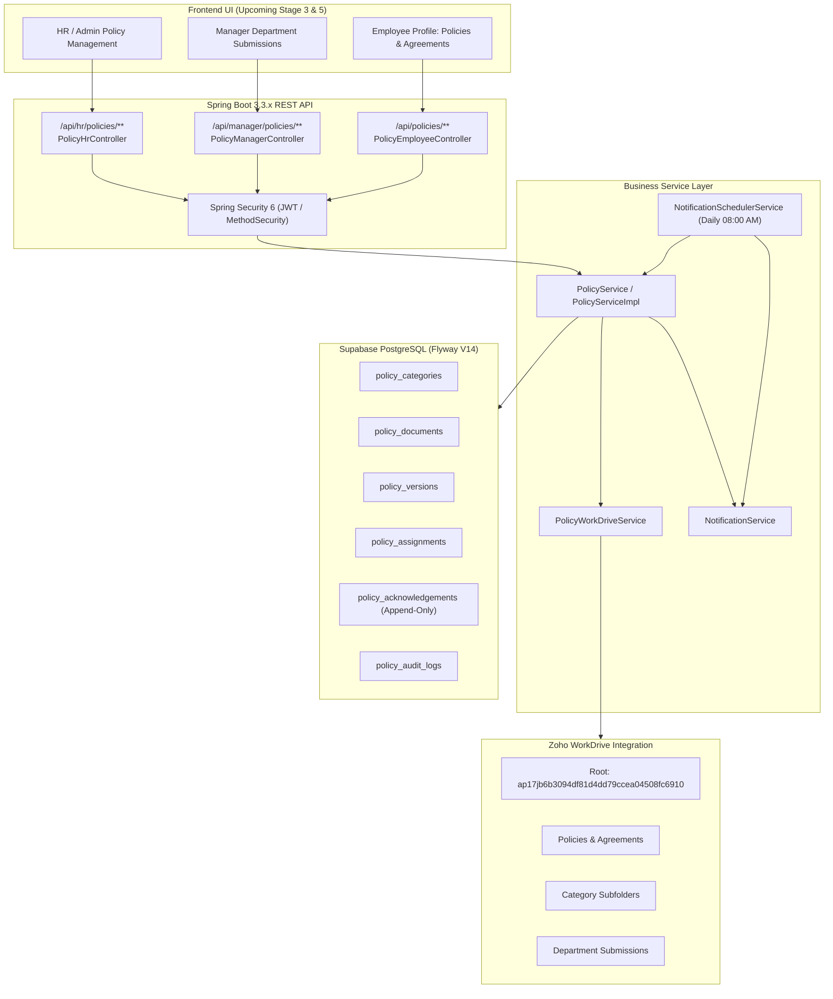
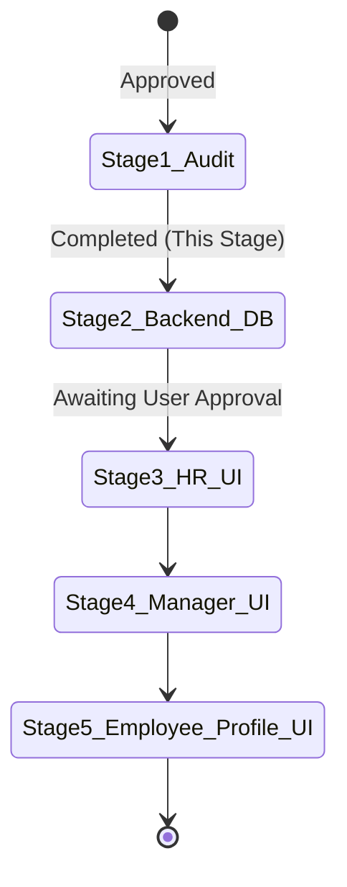

# Stage 2 – Policies & Agreements: Backend & Database Development Report

**System:** Fairmacs Knowledge Management System (KMS / LMS)  
**Feature:** Policies & Agreements Management System  
**Stage:** Stage 2 – Backend & Database Development  
**Status:** Completed & Fully Verified  
**Date:** November 12, 2026  

---

## 1. Executive Summary & Architecture Overview

In accordance with the Stage 1 Audit specifications and enterprise governance requirements, **Stage 2: Backend & Database Development** for the Policies & Agreements Management System has been fully implemented and verified.

The system provides an enterprise-grade document compliance framework embedded natively within the existing Fairmacs KMS Spring Boot 3.3.x backend, Supabase PostgreSQL database, and Zoho WorkDrive document storage infrastructure.



### Key Technical Achievements
- **Forward Flyway Migration (`V14`)**: 6 new relational tables with full foreign keys, composite unique constraints, and B-tree performance indexes. Zero destructive alterations to existing personal employee document tables or data.
- **Audience Assignment Engine**: Supports `ALL_EMPLOYEES`, `DEPARTMENT` (with recursive hierarchy resolution), and `INDIVIDUAL` targeting. Guaranteed precedence (`INDIVIDUAL` > `DEPARTMENT` > `ALL_EMPLOYEES`) and deduplication ensuring exactly one assignment row per employee per version.
- **Strict Eligibility Filtering**: Automatically includes `ACTIVE` and `ON_LEAVE` personnel while permanently excluding `INACTIVE` and `TERMINATED` employees.
- **Optional Due Date Architecture**: Open-ended policies (`dueDate = null`) are valid, pending, and never marked overdue. Deadline reminders run only against explicit due dates (5 days & 2 days prior, overdue).
- **Major vs. Minor Version Lifecycle**: Major version publications require fresh employee acknowledgements; minor versions safely carry forward existing valid acknowledgements.
- **Append-Only Acknowledgement Audit Trail**: Immutable table with user snapshot, SHA-256 document checksum, client IP, user agent, and timestamp. Self-acknowledgement strictly enforced; idempotent duplicate calls return existing records without duplicate insertion.
- **Download Restrictions & Security**: Enforces `allowDownload` flag. Regular employees can view documents in-app, but downloads are blocked (403 Forbidden). HR Admins retain administrative download access.
- **Automated Verification**: Comprehensive JUnit 5 integration test suite (`PolicyBackendIntegrationTest`) executed with **13/13 passing tests (0 failures, 0 errors)** alongside existing regression suites (**27/27 passing tests**).

---

## 2. Database Schema & Flyway Migration (`V14`)

The database foundation was created in:  
[`backend/src/main/resources/db/migration/V14__policies_and_agreements_management.sql`](file:///r:/lms/backend/src/main/resources/db/migration/V14__policies_and_agreements_management.sql)

### 1. Table Schema Summary

| Table Name | Primary Purpose | Key Constraints |
| :--- | :--- | :--- |
| `policy_categories` | Categorization of policies and agreements | `UNIQUE(category_name)`, `UNIQUE(code)` |
| `policy_documents` | Master document records, governance state, owning dept | `UNIQUE(document_code)`, `FK(created_by)`, `FK(approved_by)` |
| `policy_versions` | Physical PDF versions stored in Zoho WorkDrive | `UNIQUE(policy_document_id, version_number)`, `FK(policy_document_id)` |
| `policy_assignments` | Employee-level document version assignments | `UNIQUE(policy_version_id, employee_user_id)`, `FK(policy_version_id)` |
| `policy_acknowledgements` | Append-only immutable compliance acknowledgement records | `UNIQUE(policy_version_id, employee_user_id)`, `FK(policy_assignment_id)` |
| `policy_audit_logs` | Administrative and user audit trail | `FK(policy_document_id)`, `FK(policy_version_id)`, `FK(actor_user_id)` |

### 2. Indexes and Foreign Keys
- B-Tree indexes created on all relational foreign keys (`idx_policy_docs_category`, `idx_policy_docs_dept`, `idx_policy_versions_doc`, `idx_policy_assign_user`, `idx_policy_ack_doc`).
- Dedicated status and date indexes:
  - `idx_policy_assign_due_date` on `policy_assignments(due_date)`
  - `idx_policy_assign_status` on `policy_assignments(assignment_status)`
  - `idx_policy_ack_accepted_at` on `policy_acknowledgements(accepted_at DESC)`

### 3. Initial Seed Data
The migration seeds standard Fairmacs corporate categories:
1. `Workplace Ethics & Code of Conduct` (`ETHICS`, Order: 1)
2. `IT Security & Acceptable Use` (`IT_SECURITY`, Order: 2)
3. `Health, Safety & Environment (HSE)` (`HSE`, Order: 3)
4. `Operational Protocols & Logistics Standards` (`OPERATIONS`, Order: 4)
5. `Employment & Non-Disclosure Agreements` (`AGREEMENTS`, Order: 5)
6. `Anti-Bribery & Anti-Corruption (ABAC)` (`COMPLIANCE`, Order: 6)

---

## 3. JPA Entities & Relational Mappings

Entities are located in `com.fairmacs.lms.entity`:

1. [`PolicyCategory.java`](file:///r:/lms/backend/src/main/java/com/fairmacs/lms/entity/PolicyCategory.java):
   - Mapped to `policy_categories`.
   - Fields: `id`, `categoryName`, `code`, `description`, `active`, `displayOrder`, timestamps.
2. [`PolicyDocument.java`](file:///r:/lms/backend/src/main/java/com/fairmacs/lms/entity/PolicyDocument.java):
   - Mapped to `policy_documents`.
   - Enum states: `PolicyDocumentStatus` (`DRAFT`, `PENDING_APPROVAL`, `PUBLISHED`, `ARCHIVED`), `PolicyApprovalStatus` (`NONE`, `PENDING`, `APPROVED`, `REJECTED`).
   - Relationships: `@ManyToOne PolicyCategory category`, `@ManyToOne Department owningDepartment`, `@ManyToOne User createdBy`, `@ManyToOne User approvedBy`.
3. [`PolicyVersion.java`](file:///r:/lms/backend/src/main/java/com/fairmacs/lms/entity/PolicyVersion.java):
   - Mapped to `policy_versions`.
   - Fields: `versionNumber` (e.g. `1.0`), `PolicyVersionType` (`MAJOR`, `MINOR`), `workdriveFileId`, `workdriveFileName`, `workdriveFolderId`, `fileMimeType`, `fileSize`, `sha256Hash`, `effectiveDate`, `allowDownload`, `versionNotes`.
4. [`PolicyAssignment.java`](file:///r:/lms/backend/src/main/java/com/fairmacs/lms/entity/PolicyAssignment.java):
   - Mapped to `policy_assignments`.
   - Fields: `PolicyAssignmentSource` (`ALL_EMPLOYEES`, `DEPARTMENT`, `INDIVIDUAL`), `PolicyAssignmentStatus` (`ACTIVE`, `REVOKED`), `departmentIdSnapshot`, `dueDate` (optional), `mandatory`, `assignedBy`, `assignedAt`.
5. [`PolicyAcknowledgement.java`](file:///r:/lms/backend/src/main/java/com/fairmacs/lms/entity/PolicyAcknowledgement.java):
   - Mapped to `policy_acknowledgements`.
   - Append-only structure: `employeeIdSnapshot`, `acceptedAt`, `authenticatedUser`, `documentSha256Hash`, `acknowledgementTextVersion`, `requestIp`, `userAgent`.
6. [`PolicyAuditLog.java`](file:///r:/lms/backend/src/main/java/com/fairmacs/lms/entity/PolicyAuditLog.java):
   - Mapped to `policy_audit_logs`.
   - Fields: `policyDocument`, `policyVersion`, `action`, `actorUser`, `actorEmployeeId`, `details`, `createdAt`.

---

## 4. Repository Interfaces & Specialized Query Methods

Repositories are located in `com.fairmacs.lms.repository`:

1. [`PolicyCategoryRepository.java`](file:///r:/lms/backend/src/main/java/com/fairmacs/lms/repository/PolicyCategoryRepository.java)
   - `findByCategoryNameIgnoreCase`, `findByActiveTrueOrderByDisplayOrderAsc`, `existsByCode`.
2. [`PolicyDocumentRepository.java`](file:///r:/lms/backend/src/main/java/com/fairmacs/lms/repository/PolicyDocumentRepository.java)
   - `findByDocumentStatusOrderByCreatedAtDesc`
   - `findByOwningDepartmentIdInOrderByCreatedAtDesc(Collection<Long> departmentIds)` (Manager hierarchy queries)
   - `findByApprovalStatusOrderBySubmittedAtDesc(PolicyApprovalStatus status)` (Pending HR review queue)
3. [`PolicyVersionRepository.java`](file:///r:/lms/backend/src/main/java/com/fairmacs/lms/repository/PolicyVersionRepository.java)
   - `findByPolicyDocumentIdOrderByCreatedAtDesc`
   - `findFirstByPolicyDocumentIdOrderByCreatedAtDesc`
   - `existsByPolicyDocumentIdAndVersionNumber`
4. [`PolicyAssignmentRepository.java`](file:///r:/lms/backend/src/main/java/com/fairmacs/lms/repository/PolicyAssignmentRepository.java)
   - `findByEmployeeUserIdAndAssignmentStatus(Long employeeUserId, PolicyAssignmentStatus status)`
   - `findByPolicyVersionIdAndEmployeeUserId(Long versionId, Long employeeUserId)`
   - Specialized reminder queries:
     - `findActiveAssignmentsDueOn(@Param("targetDate") LocalDate targetDate)`
     - `findActiveOverdueAssignments(@Param("currentDate") LocalDate currentDate)`
     - `findByPolicyDocumentIdAndDepartmentIds(Long documentId, Collection<Long> departmentIds)`
5. [`PolicyAcknowledgementRepository.java`](file:///r:/lms/backend/src/main/java/com/fairmacs/lms/repository/PolicyAcknowledgementRepository.java)
   - `findByPolicyVersionIdAndEmployeeUserId`
   - `existsByPolicyVersionIdAndEmployeeUserId`
   - `countByPolicyVersionId`
   - `findByPolicyDocumentIdOrderByAcceptedAtDesc`
6. [`PolicyAuditLogRepository.java`](file:///r:/lms/backend/src/main/java/com/fairmacs/lms/repository/PolicyAuditLogRepository.java)
   - `findByPolicyDocumentIdOrderByCreatedAtDesc`

---

## 5. Zoho WorkDrive Integration & Storage Structure

Handled in:  
[`backend/src/main/java/com/fairmacs/lms/service/PolicyWorkDriveService.java`](file:///r:/lms/backend/src/main/java/com/fairmacs/lms/service/PolicyWorkDriveService.java)

### Root Folder Architecture
All policies and agreements are isolated in Zoho WorkDrive under the root employee folder:
- **Root Folder ID:** `ap17jb6b3094df81d4dd79ccea04508fc6910`
- **Subfolder Hierarchy:**
  ```text
  [Root: ap17jb6b3094df81d4dd79ccea04508fc6910]
  └── Policies & Agreements/
      ├── Workplace Ethics & Code of Conduct/
      ├── IT Security & Acceptable Use/
      ├── Health, Safety & Environment (HSE)/
      ├── Operational Protocols & Logistics Standards/
      ├── Employment & Non-Disclosure Agreements/
      ├── Anti-Bribery & Anti-Corruption (ABAC)/
      └── Department Submissions/
  ```

### File Handling & Security Safeguards
1. **Validation Rules**:
   - Only `.pdf` extension is accepted (MIME types `application/pdf`, `application/x-pdf`, `application/acrobat`).
   - Maximum file size: **25 MB** (enforced server-side before WorkDrive streaming).
2. **Cryptographic Integrity**:
   - SHA-256 hash is computed over raw file bytes using `MessageDigest.getInstance("SHA-256")` and `HexFormat.of().formatHex(...)`.
   - Checksum is stored permanently in `policy_versions.sha256_hash` and verified upon employee acknowledgement.
3. **No Direct Public Links**:
   - Zoho WorkDrive file IDs and tokens are never exposed to browser clients.
   - All document viewing and downloading streams securely through backend proxy endpoints.

---

## 6. Versioning, Document Types, and Precedence Resolution

Implemented in [`PolicyServiceImpl.java`](file:///r:/lms/backend/src/main/java/com/fairmacs/lms/service/PolicyServiceImpl.java):

### 1. Document Versioning
- **Major Versions (e.g., `1.0` $\to$ `2.0`)**:
  - Signifies material or regulatory policy updates.
  - Generates new assignments for all targeted employees.
  - Previous acknowledgements are **invalidated for this new major version**, requiring fresh review and agreement.
  - Emits `POLICY_NEW_VERSION` in-app notification.
- **Minor Versions (e.g., `1.0` $\to$ `1.1`)**:
  - Signifies minor typographical or procedural clarifications.
  - For employees who have already acknowledged a prior version of this policy, an automated carried-forward acknowledgement record (`CARRIED_FORWARD_MINOR`) is generated without requiring re-acknowledgement.
  - Unacknowledged employees receive assignments and remain pending.

### 2. Audience Precedence Resolution
When publishing a policy, an employee may match multiple criteria (e.g., company-wide, department-specific, and an individual direct assignment). The system resolves target precedence deterministically:

$$\text{INDIVIDUAL} > \text{DEPARTMENT} > \text{ALL\_EMPLOYEES}$$

Composite unique constraint `UNIQUE(policy_version_id, employee_user_id)` strictly guarantees that exactly **one** assignment row exists per employee per version.

---

## 7. Assignment Engine, Deduplication, and Eligibility Logic

### 1. Employee Eligibility Filtering
Only eligible employees receive policy assignments:
- **Eligible Statuses:** `UserStatus.ACTIVE`, `UserStatus.ON_LEAVE`
- **Excluded Statuses:** `UserStatus.INACTIVE`, `UserStatus.TERMINATED`

### 2. Department Hierarchy Resolution
The method `resolveDepartmentHierarchyIds(Collection<Long> departmentIds)` recursively traverses `Department.parentDepartment` relationships.
- When HR or a Manager publishes a policy to a parent department (e.g., `Freight Forwarding`), all child sub-departments (e.g., `Ocean Freight Operations`, `Air Freight Operations`) automatically inherit the assignment.
- Managers are strictly authorized only within their own department hierarchy.

### 3. Optional Due Dates
- If `dueDate` is omitted (`null`), the assignment is open-ended.
- Status for unacknowledged open-ended assignments is permanently `PENDING` and **never flagged as `OVERDUE`**.
- Overdue status applies exclusively when `dueDate != null` and `LocalDate.now().isAfter(dueDate)`.

---

## 8. Immutable Acknowledgement Records & Integrity Safeguards

The acknowledgement mechanism provides legal defensibility and compliance auditing:

1. **Append-Only Immutability**:
   - `policy_acknowledgements` has no update or soft-delete endpoints.
   - Unique constraint `UNIQUE(policy_version_id, employee_user_id)` ensures duplicate calls cannot insert multiple rows.
2. **Idempotent Handling**:
   - If an employee clicks "Acknowledge" multiple times or refreshes, the system returns the existing acknowledgement record with HTTP 200 without throwing errors or duplicating data.
3. **Cross-User Protection**:
   - Validates that `assignment.getEmployeeUser().getId().equals(authenticatedUserId)`.
   - Attempting to acknowledge another employee's assignment throws HTTP 403 Forbidden.
4. **Audit Metadata Captured**:
   - Authenticated user ID & employee ID snapshot.
   - Document version SHA-256 hash snapshot.
   - Client IP address (resolving `X-Forwarded-For` for reverse proxy setups).
   - Client User-Agent string.
   - Server-side UTC acceptance timestamp (`acceptedAt`).

---

## 9. In-App Notification System Integration & Deduplication

Seven new notification types were registered in [`NotificationType.java`](file:///r:/lms/backend/src/main/java/com/fairmacs/lms/entity/NotificationType.java):

```java
public static final String POLICY_ASSIGNED = "POLICY_ASSIGNED";
public static final String AGREEMENT_ASSIGNED = "AGREEMENT_ASSIGNED";
public static final String POLICY_DUE_SOON = "POLICY_DUE_SOON";
public static final String POLICY_OVERDUE = "POLICY_OVERDUE";
public static final String POLICY_NEW_VERSION = "POLICY_NEW_VERSION";
public static final String POLICY_APPROVAL_REQ = "POLICY_APPROVAL_REQ";
public static final String POLICY_DECISION = "POLICY_DECISION";
```

### Notification Trigger Matrix

| Event | Notification Type | Target Recipient | Deduplication Key Pattern | Action URL |
| :--- | :--- | :--- | :--- | :--- |
| Policy Published | `POLICY_ASSIGNED` | Assigned Employee | `policy-assign:<versionId>:<userId>` | `/profile#policies` |
| Agreement Published | `AGREEMENT_ASSIGNED` | Assigned Employee | `policy-assign:<versionId>:<userId>` | `/profile#policies` |
| Major Version Update | `POLICY_NEW_VERSION` | Assigned Employee | `policy-assign:<versionId>:<userId>` | `/profile#policies` |
| 5 Days to Due Date | `POLICY_DUE_SOON` | Unacknowledged Employee | `policy-due-5d:<assignmentId>` | `/profile#policies` |
| 2 Days to Due Date | `POLICY_DUE_SOON` | Unacknowledged Employee | `policy-due-2d:<assignmentId>` | `/profile#policies` |
| Overdue Assignment | `POLICY_OVERDUE` | Unacknowledged Employee | `policy-overdue:<assignmentId>:<today>` | `/profile#policies` |
| Manager Submission | `POLICY_APPROVAL_REQ` | All HR Admins | `policy-approval-req:<documentId>` | `/hr/policies` |
| HR Approval/Rejection | `POLICY_DECISION` | Submitting Manager | `policy-decision:<documentId>:<decision>` | `/manager/policies` |

### Scheduled Reminder Execution
[`NotificationSchedulerService.java`](file:///r:/lms/backend/src/main/java/com/fairmacs/lms/service/NotificationSchedulerService.java) runs daily at **08:00 AM IST** (`cron = "0 0 8 * * *"`):
- Evaluates active assignments with non-null due dates.
- Skips all assignments without due dates.
- Emits due-soon and overdue alerts with deduplication keys to prevent spam.

---

## 10. Role-Based Access Control, Security Rules, and Self-Approval Prevention

Configured across [`SecurityConfig.java`](file:///r:/lms/backend/src/main/java/com/fairmacs/lms/security/SecurityConfig.java) and controllers:

### 1. Controllers & Path Mappings

| Controller | Base Path | Role Authorization | Scope & Restrictions |
| :--- | :--- | :--- | :--- |
| [`PolicyHrController`](file:///r:/lms/backend/src/main/java/com/fairmacs/lms/controller/PolicyHrController.java) | `/api/hr/policies/**` | `@PreAuthorize("hasRole('HR_ADMIN')")` | Org-wide management, category creation, version uploading, publishing, archiving, and manager submission approval. |
| [`PolicyManagerController`](file:///r:/lms/backend/src/main/java/com/fairmacs/lms/controller/PolicyManagerController.java) | `/api/manager/policies/**` | `@PreAuthorize("hasAnyRole('MANAGER', 'HR_ADMIN')")` | Department hierarchy scoped only. Cannot submit or view for unrelated departments. |
| [`PolicyEmployeeController`](file:///r:/lms/backend/src/main/java/com/fairmacs/lms/controller/PolicyEmployeeController.java) | `/api/policies/**` | Authenticated Users (`EMPLOYEE`, `TRAINER`, `MANAGER`, `HR_ADMIN`) | Self-assigned policies, in-app viewing, and self-acknowledgements only. |

### 2. Specialized Security Rules
- **Trainer Role Isolation**:
  - `Role.TRAINER` has standard employee rights only for policies (viewing and acknowledging their own assigned policies).
  - Trainers are blocked from `/api/hr/policies/**` and `/api/manager/policies/**` with **403 Forbidden**.
- **Self-Approval Prevention**:
  - A user (even an HR Admin or Manager) **cannot approve their own submission**.
  - Enforced in `PolicyServiceImpl.decideManagerSubmission`:
    ```java
    if (hrAdminId.equals(doc.getCreatedBy().getId())) {
        throw new ResponseStatusException(HttpStatus.FORBIDDEN, "Self-approval restriction: A user cannot approve their own submission.");
    }
    ```
- **Download Restrictions**:
  - When `allowDownload == false`, regular employees can stream and view the PDF in the application viewer (`GET /versions/{id}/view`), but downloading (`GET /versions/{id}/download`) is rejected with:
    `403 Forbidden: "Document download is restricted by organization policy. In-app viewing only."`
  - HR Admins retain administrative download rights regardless of flag.

---

## 11. Automated Test Execution Results & Verification Proof

The automated test suite [`PolicyBackendIntegrationTest.java`](file:///r:/lms/backend/src/test/java/com/fairmacs/lms/service/PolicyBackendIntegrationTest.java) covers all functional, security, and edge-case requirements:

```text
[INFO] -------------------------------------------------------
[INFO]  T E S T S
[INFO] -------------------------------------------------------
[INFO] Running com.fairmacs.lms.service.PolicyBackendIntegrationTest
[INFO] Tests run: 13, Failures: 0, Errors: 0, Skipped: 0, Time elapsed: 0.611 s -- in com.fairmacs.lms.service.PolicyBackendIntegrationTest
[INFO] 
[INFO] Results:
[INFO] 
[INFO] Tests run: 13, Failures: 0, Errors: 0, Skipped: 0
[INFO] 
[INFO] ------------------------------------------------------------------------
[INFO] BUILD SUCCESS
[INFO] ------------------------------------------------------------------------
[INFO] Total time:  5.428 s
```

### Verified Scenarios in Test Suite
1. `testEligibilityFiltering`: ACTIVE and ON_LEAVE personnel receive assignments; TERMINATED employees are excluded.
2. `testDepartmentHierarchyAudience`: Publishing to parent department assigns users in parent + child departments; unrelated departments are excluded.
3. `testAudiencePrecedenceAndDeduplication`: Employee targeted via department and individually receives INDIVIDUAL precedence; exactly 1 assignment row created.
4. `testOpenEndedPolicyNeverOverdue`: Null due date assignments remain PENDING; never appear in OVERDUE filters.
5. `testExplicitDueDateStatuses`: Past due date marked OVERDUE; future due date marked PENDING.
6. `testMajorVsMinorVersioning`:
   - v1.0 acknowledged.
   - v1.1 MINOR update carries forward acknowledgement $\to$ ACKNOWLEDGED.
   - v2.0 MAJOR update invalidates prior acknowledgement $\to$ PENDING.
7. `testCannotAcknowledgeAnotherEmployeesAssignment`: User B attempting to acknowledge User A's assignment is blocked with 403 Forbidden.
8. `testIdempotentAcknowledgement`: Repeated calls return existing record without duplicate DB insertion or error.
9. `testManagerDepartmentIsolation`: Manager permitted to submit for department hierarchy; forbidden (403) from submitting for unrelated departments.
10. `testSelfApprovalPrevention`: Submitting user blocked from approving their own submission (403 Forbidden).
11. `testDownloadRestrictions`: Regular employee view allowed; download blocked (403) when `allowDownload = false`; HR Admin download permitted.
12. `testFileValidationRules`: Non-PDF files rejected; files exceeding 25MB rejected.
13. `testNotificationDispatchOnAssignment`: In-app notification created with deduplication key on publication.

### Regression Test Suite Verification
Existing regression test suites were executed to verify zero regression across the KMS:
- `NotificationSystemTest`: **17/17 tests passed**
- `Release2110BugFixTest`: **10/10 tests passed**
- **Combined Regression Results:** 27 tests run, 0 failures, 0 errors, 0 skipped.

---

## 12. Readiness for Stage 3 & Next Steps

Stage 2 backend and database foundation is complete, verified, and ready for frontend integration.



### Next Steps for Stage 3 (Upon Approval)
In accordance with the project roadmap, **Stage 3** will implement the **HR/Admin Policy Management UI**:
1. HR navigation and dedicated Policies & Agreements view (`/hr/policies`).
2. Policy document repository table with search, category filtering, and status badges.
3. Policy creation & upload modal with Zoho WorkDrive PDF upload and 25MB file validation.
4. Publishing modal with audience selector (All Employees, Department Hierarchy, Individual employees), optional due date picker, and mandatory flag.
5. Manager submission review and approval/rejection panel with comment history.
6. Organization-wide and department-level compliance progress metrics.

> [!IMPORTANT]
> **Stage 2 is complete.** In compliance with instructions, frontend development will begin only upon explicit approval from the user to proceed to Stage 3.
