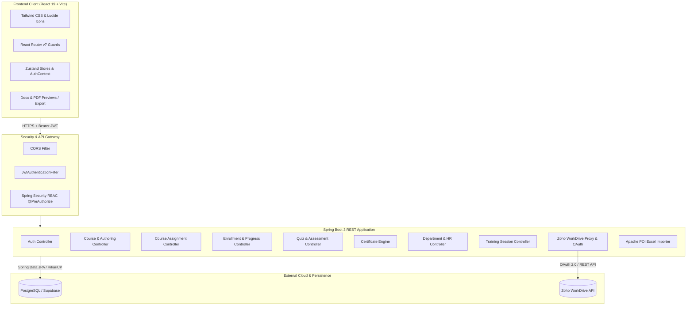

# Fairmacs Knowledge Management System

[](https://spring.io/projects/spring-boot)
[](https://react.dev/)
[](https://vite.dev/)
[](https://supabase.com/)
[](https://workdrive.zoho.com/)
[](https://tailwindcss.com/)
[](https://adoptium.net/)
[](#license)

**Fairmacs KMS** is a modern, enterprise-grade Knowledge Management System engineered specifically for corporate workforce training, role-based skill development, mandatory compliance tracking, and verifiable credentialing across global freight forwarding and logistics operations.

Built on an asynchronous, decoupled architecture with a **React 19 + Vite** single-page application on the frontend and a **Spring Boot 3 + PostgreSQL (Supabase)** microservice-ready backend, with integrated cloud document storage via **Zoho WorkDrive OAuth 2.0**.

---

## 📑 Table of Contents

- [Core Capabilities & Highlights](#-core-capabilities--highlights)
- [Role-Based Access Control (RBAC)](#-role-based-access-control-rbac)
- [System Architecture](#-system-architecture)
- [Technology Stack](#-technology-stack)
- [Project Directory Layout](#-project-directory-layout)
- [Security & Credential Management](#-security--credential-management)
- [Prerequisites](#-prerequisites)
- [Environment Configuration](#-environment-configuration)
  - [Backend Environment Variables](#backend-environment-variables)
  - [Frontend Environment Variables](#frontend-environment-variables)
- [Getting Started Locally](#-getting-started-locally)
  - [1. Backend Setup (Spring Boot)](#1-backend-setup-spring-boot)
  - [2. Frontend Setup (React + Vite)](#2-frontend-setup-react--vite)
- [Complete REST API Reference](#-complete-rest-api-reference)
- [Production Build & Deployment](#-production-build--deployment)
- [Security Auditing & Clean Git Policies](#-security-auditing--clean-git-policies)
- [License](#-license)

---

## 🚀 Core Capabilities & Highlights

### 1. 🎓 Course Authoring & Curriculum Management
- **Hierarchical Course Structure**: Author full courses partitioned into sequential Modules and Lessons.
- **Rich Media & Multi-Format Content**: Embed video lectures (YouTube, MP4 streams) and cloud-hosted documents (PDF, DOCX) directly into lesson steps.
- **Draft & Versioning Flow**: Save multi-module drafts incrementally with auto-save before publishing to the active catalog.
- **Zoho WorkDrive Cloud Uploads**: Seamlessly attach documents to course lessons directly via the Zoho WorkDrive integration.

### 2. 🎯 Course Assignment & Targeted Enrollment Engine
- **Targeted Training Delivery**: Assign courses by **Department**, **Employee Group**, or **Individual Employees**.
- **Mandatory vs. Elective Designations**: Enforce strict completion due dates on compliance-critical courses with automated overdue tracking.
- **Self-Paced Learning**: Employees can explore the open catalog, self-enroll, and track individual skill milestones.

### 3. 🧪 Server-Authoritative Quiz & Assessment Engine
- **Anti-Cheat & Server-Side Evaluation**: Quiz questions, answers, and scoring thresholds are securely evaluated on the backend.
- **Timed Attempts**: Configurable timers and attempt ceilings with automated result calculations.
- **Real-Time Grade Feedback**: Detailed score summaries, passing grade verifications, and instant review capabilities.

### 4. 📜 Automated Verifiable PDF Certification
- **Dynamic Certificate Generation**: Upon course completion and passing grade validation, an official PDF certificate is generated server-side using OpenPDF.
- **Unique Verification Identifier**: Every certificate receives a tamper-resistant serial ID (e.g., `FM-CERT-2026-9516`).
- **In-App Viewer & Downloader**: Interactive modal certificate preview with direct PDF download and browser-side verification.

### 5. 🏢 Department Management & Course Matrix
- **Department Drilldowns**: Inspect departmental headcounts, active courses, average completion metrics, and managers.
- **Course Matrix View**: Matrix mapping of department members against assigned courses to pinpoint knowledge gaps.

### 6. 👥 Comprehensive Employee Lifecycle & Bulk Import
- **Lifecycle Status Tracking**: Full lifecycle states (`ACTIVE`, `INACTIVE`, `ON_LEAVE`, `TERMINATED`).
- **Bulk Excel Import (`.xlsx`)**: High-performance batch onboarding powered by Apache POI with fuzzy column matching, automated validation, department assignment, and initial password generation.
- **Role Assignment**: Dynamically allocate and update employee roles (`EMPLOYEE`, `TRAINER`, `MANAGER`, `HR_ADMIN`).

### 7. 📊 Advanced Analytics & Multi-Format Reporting
- **HR Compliance Hub**: System-wide completion rates, department-level compliance metrics, and overdue training registries.
- **Manager Team Transcripts**: Granular team reporting with employee-by-employee progress, scores, and completion histories.
- **One-Click Multi-Format Export**: Export any analytics table instantly to **Microsoft Excel (`.xlsx`)** via `exceljs` or **PDF** via `jspdf` & `jspdf-autotable`.

### 8. 📅 Corporate Training Calendar & Notifications
- **Event Scheduling**: Schedule Workshops, Webinars, Assessments, and Deadlines with targeted audiences (`ALL`, `DEPARTMENT`, or `EMPLOYEES`).
- **Interactive Calendar UI**: Monthly, weekly, and day-filtered views of upcoming corporate training sessions.
- **Real-Time Notification Center**: Push notifications for new course assignments, deadline reminders, quiz attempts, and certificates.

### 9. ☁️ Zoho WorkDrive Cloud Storage Integration
- **OAuth 2.0 Authorization**: Secure authorization flow with authorization code exchange and automated background token renewal.
- **AES-256 Encrypted Token Persistence**: OAuth refresh tokens are encrypted at rest in the database using AES-GCM.
- **Document Streaming Proxy**: Documents are streamed securely from Zoho WorkDrive through the backend without exposing raw cloud credentials to clients.

---

## 👥 Role-Based Access Control (RBAC)

The system enforces strict Spring Security method-level authorization (`@PreAuthorize`) and frontend route guards across four distinct user roles:

| Capability / Resource | Employee | Trainer | Manager | HR Admin |
|---|:---:|:---:|:---:|:---:|
| Browse Public Course Catalog | ✅ | ✅ | ✅ | ✅ |
| Track Personal Learning & Progress | ✅ | ✅ | ✅ | ✅ |
| Take Quizzes & Download Certificates | ✅ | ✅ | ✅ | ✅ |
| Access In-App Notifications | ✅ | ✅ | ✅ | ✅ |
| View Corporate Training Calendar | ✅ | ✅ | ✅ | ✅ |
| Course Builder & Curriculum Authoring | ❌ | ✅ | ❌ | ✅ |
| Manage Draft Courses | ❌ | ✅ | ❌ | ✅ |
| Upload Course Documents to Zoho | ❌ | ✅ | ❌ | ✅ |
| View Direct Reports' Training Transcripts | ❌ | ❌ | ✅ | ✅ |
| Monitor Team Compliance & Overdue Status | ❌ | ❌ | ✅ | ✅ |
| Department Management & Course Matrix | ❌ | ❌ | ❌ | ✅ |
| Assign Courses (Department / Employee) | ❌ | ❌ | ❌ | ✅ |
| Employee Directory & Profile Management | ❌ | ❌ | ❌ | ✅ |
| Bulk Excel Employee Import (`.xlsx`) | ❌ | ❌ | ❌ | ✅ |
| Connect / Manage Zoho WorkDrive OAuth | ❌ | ❌ | ❌ | ✅ |
| Schedule Training Sessions & Deadlines | ❌ | ✅ | ✅ | ✅ |
| System-Wide Audit & HR Analytics | ❌ | ❌ | ❌ | ✅ |

---

## 🏗 System Architecture



---

## 🛠 Technology Stack

### Frontend Architecture
| Component | Technology | Version | Description |
|---|---|---|---|
| **Framework** | [React](https://react.dev/) | `19.2.8` | Declarative component UI library |
| **Bundler & Server** | [Vite](https://vite.dev/) | `8.3.0` | Ultra-fast build tool and HMR dev server |
| **Routing** | [React Router](https://reactrouter.com/) | `7.x` | Client-side declarative routing and role guards |
| **State Management** | [Zustand](https://zustand.docs.pmnd.rs/) | `5.x` | Minimalist and fast centralized state management |
| **Styling** | [Tailwind CSS](https://tailwindcss.com/) | `4.x` | Utility-first styling framework |
| **Icons** | [Lucide React](https://lucide.dev/) | `1.47.0` | Modern, consistent icon library |
| **Excel Export** | [ExcelJS](https://github.com/exceljs/exceljs) | `4.4.0` | Client-side spreadsheet generation |
| **PDF Export** | [jsPDF](https://github.com/parallax/jsPDF) + AutoTable | `4.2.1` | In-browser PDF generation and table exports |
| **Document Viewer** | [docx-preview](https://github.com/Volser/docx-preview) | `0.4.1` | Client-side DOCX rendering without server dependency |
| **Micro-Animations** | [canvas-confetti](https://www.npmjs.com/package/canvas-confetti) | `1.9.4` | Visual celebration upon course completion |

### Backend Architecture
| Component | Technology | Version | Description |
|---|---|---|---|
| **Runtime & Core** | [Java SE](https://adoptium.net/) | `17 LTS` | Modern Java platform |
| **Framework** | [Spring Boot](https://spring.io/projects/spring-boot) | `3.2.0` | Enterprise application framework |
| **Security** | Spring Security + [JJWT](https://github.com/jwtk/jjwt) | `0.12.3` | Stateless Bearer token authentication & authorization |
| **Database ORM** | Spring Data JPA / Hibernate | `6.x` | Relational data mapping and repository abstraction |
| **Database** | PostgreSQL ([Supabase](https://supabase.com/)) | `15+` | Enterprise-grade cloud relational database |
| **PDF Generation** | [OpenPDF](https://github.com/LibrePDF/OpenPDF) | `1.3.39` | High-fidelity server-side certificate rendering |
| **Excel Ingestion** | [Apache POI](https://poi.apache.org/) (poi-ooxml) | `5.4.1` | High-performance Excel (`.xlsx`) bulk employee parser |
| **HTTP Client** | Spring `RestTemplate` | `3.2.0` | Secure integration client for Zoho WorkDrive |
| **Build Tool** | Apache Maven | `3.8+` | Dependency management and build automation |

---

## 📁 Project Directory Layout

```
fairmacs-lms/
├── .gitignore                                 # Git rules (excludes secrets, uploads, dumps)
├── .env.example                               # Frontend environment template
├── README.md                                  # Complete project documentation
│
├── frontend/                                  # React 19 + Vite Application
│   ├── public/                                # Public assets & branding icons
│   ├── src/
│   │   ├── components/                        # Modular React views and widgets
│   │   │   ├── CourseAssignmentModal.jsx      # Department & employee course assignment
│   │   │   ├── CourseBuilderModal.jsx         # Curriculum creator (Modules, Lessons, Docs)
│   │   │   ├── CourseViewer.jsx               # Interactive video & document lesson player
│   │   │   ├── DepartmentCourseEmployees.jsx  # Department course employee matrix
│   │   │   ├── DepartmentDetails.jsx          # Department-specific metrics & team
│   │   │   ├── DepartmentManagement.jsx       # Department list, metrics & actions
│   │   │   ├── Drafts.jsx                     # Saved course drafts editor
│   │   │   ├── EmployeeManagement.jsx         # Employee CRUD & Excel import modal
│   │   │   ├── HrAdminDashboard.jsx           # Main HR administration control center
│   │   │   ├── ManagerAllCourses.jsx          # Manager catalog oversight view
│   │   │   ├── ManagerDashboard.jsx           # Manager team progress dashboard
│   │   │   ├── MyLearning.jsx                 # Learner enrolled courses and progress
│   │   │   ├── Overview.jsx                   # High-level learner dashboard summary
│   │   │   ├── QuizModal.jsx                  # Timed assessment engine
│   │   │   ├── ReportsView.jsx                # Multi-format report center (Excel & PDF)
│   │   │   ├── TrainerDashboard.jsx           # Trainer course catalog & draft control
│   │   │   ├── TrainingAssignmentModal.jsx    # Session scheduling & attendee selection
│   │   │   ├── TrainingCalendar.jsx           # Interactive corporate calendar
│   │   │   └── ...
│   │   ├── context/
│   │   │   └── AuthContext.jsx                # User session, login, logout, password change
│   │   ├── services/                          # API clients (Axios/Fetch abstractions)
│   │   │   ├── enrollmentService.js           # Learning progress & course enrollments
│   │   │   ├── hrAdminService.js              # HR and employee administrative calls
│   │   │   ├── quizService.js                 # Quiz start, progress & submission
│   │   │   └── zohoService.js                 # Zoho WorkDrive connect & status APIs
│   │   ├── stores/                            # Zustand reactive stores
│   │   ├── App.jsx                            # Root layout, role routing & navigation
│   │   └── main.jsx                           # Application entry point
│   ├── package.json
│   └── vite.config.js
│
└── backend/                                   # Spring Boot 3 REST Application
    ├── pom.xml                                # Maven build specifications
    └── src/main/
        ├── java/com/fairmacs/lms/
        │   ├── config/                        # Spring configuration & data seeders
        │   │   ├── DepartmentDataInitializer.java
        │   │   └── LmsDataInitializer.java
        │   ├── controller/                    # REST API Controllers
        │   │   ├── AuthController.java
        │   │   ├── CertificateController.java
        │   │   ├── CourseAssignmentController.java
        │   │   ├── CourseController.java
        │   │   ├── DepartmentController.java
        │   │   ├── DraftController.java
        │   │   ├── EnrollmentController.java
        │   │   ├── HrAdminController.java
        │   │   ├── HrReportController.java
        │   │   ├── LessonDocumentController.java
        │   │   ├── LessonProgressController.java
        │   │   ├── ManagerAllCoursesController.java
        │   │   ├── ManagerReportController.java
        │   │   ├── NotificationController.java
        │   │   ├── QuizController.java
        │   │   ├── QuizProgressController.java
        │   │   └── TrainingSessionController.java
        │   ├── dto/                           # Data Transfer Objects
        │   ├── entity/                        # JPA Database Entities
        │   │   ├── Course.java
        │   │   ├── Department.java
        │   │   ├── Enrollment.java
        │   │   ├── Lesson.java
        │   │   ├── Module.java
        │   │   ├── Notification.java
        │   │   ├── Quiz.java
        │   │   ├── QuizAttempt.java
        │   │   ├── TrainingSession.java
        │   │   └── User.java
        │   ├── integration/zoho/              # Zoho WorkDrive Cloud Integration
        │   │   ├── ZohoOAuthController.java
        │   │   ├── ZohoOAuthService.java      # AES-256 encrypted token handling
        │   │   ├── ZohoWorkDriveDownloadService.java
        │   │   ├── ZohoWorkDriveService.java
        │   │   └── ZohoWorkDriveTestController.java
        │   ├── repository/                    # Spring Data JPA Repositories
        │   ├── security/                      # JWT authentication & Spring Security
        │   │   ├── JwtAuthenticationFilter.java
        │   │   ├── JwtTokenProvider.java
        │   │   ├── SecurityConfig.java
        │   │   └── SecurityContextUtil.java
        │   └── service/                       # Business Logic Layer
        │       ├── CourseAuthoringService.java
        │       ├── DepartmentService.java
        │       ├── DraftService.java
        │       ├── EmployeeExcelImportService.java
        │       ├── EnrollmentService.java
        │       ├── HrAdminService.java
        │       ├── LessonDocumentAccessService.java
        │       ├── ManagerReportService.java
        │       ├── QuizService.java
        │       └── TrainingSessionService.java
        └── resources/
            ├── application.properties         # Environment-driven configuration
            └── application.properties.example # Documented template for setup
```

---

## 🔐 Security & Credential Management

Fairmacs KMS is architected under **Zero-Credential-in-Code** principles:

1. **Pure Environment Variable Injection**: No database credentials, API keys, client secrets, or cryptographic tokens are ever committed to the repository.
2. **Local Configuration Decoupling**: Developers can optionally use `application-local.properties` (which is strictly ignored by Git) to override local settings without risking accidental commits.
3. **AES-256 Cloud Token Encryption**: Zoho OAuth refresh tokens are encrypted using AES-GCM-256 before being stored in the database.
4. **BCrypt Password Security**: All employee passwords are salted and hashed using BCrypt. The system never stores or transmits plaintext passwords.
5. **Stateless JWT Authorization**: Requests are secured via signed HMAC-SHA-256 JSON Web Tokens with strict expiry checks and user status verification.
6. **Git Protection Rules**: Database dumps (`*.dump`, `*.sql`), user upload directories (`backend/uploads/`), IDE artifacts (`.trae/`, `.vscode/`), and local environment files (`.env`, `*local.properties`) are all registered in `.gitignore`.

---

## 📋 Prerequisites

Before running the application, make sure the following dependencies are installed on your workstation:

| Prerequisite | Minimum Version | Installation Link |
|---|---|---|
| **Java Development Kit (JDK)** | Java 17 LTS | [Eclipse Temurin](https://adoptium.net/) |
| **Node.js & npm** | Node.js v18+ & npm v9+ | [Node.js Official](https://nodejs.org/) |
| **Apache Maven** | Maven 3.8+ | [Apache Maven](https://maven.apache.org/) (or use `mvnw`) |
| **PostgreSQL Database** | PostgreSQL 14+ | Local instance or [Supabase](https://supabase.com/) |

---

## ⚙️ Environment Configuration

### Backend Environment Variables

Configure the following environment variables on your system, or supply them in a private `backend/src/main/resources/application-local.properties` file:

| Variable | Description | Required | Example Value |
|---|---|:---:|---|
| `SUPABASE_DB_URL` | JDBC Connection URL to PostgreSQL | **Yes** | `jdbc:postgresql://db.xxxx.supabase.co:5432/postgres?sslmode=require` |
| `SUPABASE_DB_USERNAME` | Database username | **Yes** | `postgres` |
| `SUPABASE_DB_PASSWORD` | Database password | **Yes** | `YourSecretPasswordHere` |
| `JWT_SECRET` | 256-bit secret key for HMAC SHA JWT | **Yes** | `404E635266556A586E3272357538782F413F4428472B4B6250645367566B5970` |
| `ZOHO_CLIENT_ID` | Zoho WorkDrive API Client ID | Optional | `1000.XXXXXXXXXXXXXXXXXXXXXXXXXXXXXX` |
| `ZOHO_CLIENT_SECRET` | Zoho WorkDrive API Client Secret | Optional | `xxxxxxxxxxxxxxxxxxxxxxxxxxxxxxxx` |
| `ZOHO_REDIRECT_URI` | Zoho OAuth 2.0 Redirect URI | Optional | `http://localhost:8080/api/integrations/zoho/callback` |
| `ZOHO_TOKEN_ENCRYPTION_KEY` | 32-byte Base64 AES key for OAuth tokens | Optional | `k8yW5f8f9Q3b4+6fX+7t8Y8Z...` |
| `ZOHO_COURSE_DOCUMENTS_FOLDER_ID` | Target folder ID in Zoho WorkDrive | Optional | `uqi2q368e8c06e5bc44de87954550476aa546` |
| `server.port` | Spring Boot HTTP port | No | `8080` (default) |

> A ready-to-use template is available at [`backend/src/main/resources/application.properties.example`](backend/src/main/resources/application.properties.example).

### Frontend Environment Variables

Create a file named `.env` in the `frontend/` folder (or copy from `.env.example`):

```env
VITE_API_BASE_URL=http://localhost:8080/api
```

---

## 🚀 Getting Started Locally

### 1. Backend Setup (Spring Boot)

1. Navigate to the backend directory:
   ```bash
   cd backend
   ```

2. Export your environment variables:

   **Windows (PowerShell)**:
   ```powershell
   $env:SUPABASE_DB_URL="jdbc:postgresql://<host>:5432/<database>?sslmode=require"
   $env:SUPABASE_DB_USERNAME="postgres"
   $env:SUPABASE_DB_PASSWORD="<your_secure_password>"
   $env:JWT_SECRET="<your_jwt_secret_min_256_bits>"
   $env:ZOHO_CLIENT_ID="<your_zoho_client_id>"
   $env:ZOHO_CLIENT_SECRET="<your_zoho_client_secret>"
   $env:ZOHO_TOKEN_ENCRYPTION_KEY="<base64_encoded_32_byte_aes_key>"
   ```

   **macOS / Linux (Bash / Zsh)**:
   ```bash
   export SUPABASE_DB_URL="jdbc:postgresql://<host>:5432/<database>?sslmode=require"
   export SUPABASE_DB_USERNAME="postgres"
   export SUPABASE_DB_PASSWORD="<your_secure_password>"
   export JWT_SECRET="<your_jwt_secret_min_256_bits>"
   export ZOHO_CLIENT_ID="<your_zoho_client_id>"
   export ZOHO_CLIENT_SECRET="<your_zoho_client_secret>"
   export ZOHO_TOKEN_ENCRYPTION_KEY="<base64_encoded_32_byte_aes_key>"
   ```

3. Compile and start the backend service:
   ```bash
   mvn spring-boot:run
   ```
   *The backend will boot up at `http://localhost:8080`.*

---

### 2. Frontend Setup (React + Vite)

1. In a separate terminal, navigate to the frontend directory:
   ```bash
   cd frontend
   ```

2. Install all required dependencies:
   ```bash
   npm install
   ```

3. Launch the Vite development server:
   ```bash
   npm run dev
   ```

4. Open your web browser and navigate to:
   ```
   http://localhost:5173
   ```

---

## 📡 Complete REST API Reference

All backend endpoints are prefixed with `/api`. Protected routes require a Bearer token in the request header:
`Authorization: Bearer <jwt-token>`

### 1. Authentication & User Profile
| Method | Endpoint | Access | Description |
|---|---|---|---|
| `POST` | `/api/auth/login` | Public | Authenticate credentials and receive JWT |
| `GET` | `/api/auth/me` | Authenticated | Retrieve authenticated user profile |
| `POST` | `/api/auth/change-password` | Authenticated | Change user password with BCrypt verification |
| `POST` | `/api/auth/verify-password` | Authenticated | Verify existing password validity |

### 2. Course Catalog & Curriculum
| Method | Endpoint | Access | Description |
|---|---|---|---|
| `GET` | `/api/courses` | Authenticated | List all active published courses |
| `GET` | `/api/courses/{id}` | Authenticated | Retrieve full course details with modules and lessons |
| `POST` | `/api/courses/authoring/create` | Trainer, HR Admin | Create and publish a new course with curriculum |
| `PUT` | `/api/courses/authoring/{id}` | Trainer, HR Admin | Update an existing course and its curriculum |
| `DELETE` | `/api/courses/authoring/{id}` | Trainer, HR Admin | Delete a course |

### 3. Course Drafts (Authoring in Progress)
| Method | Endpoint | Access | Description |
|---|---|---|---|
| `GET` | `/api/courses/drafts` | Trainer, HR Admin | List all saved course drafts |
| `POST` | `/api/courses/drafts` | Trainer, HR Admin | Save or update a course draft |
| `GET` | `/api/courses/drafts/{id}` | Trainer, HR Admin | Load a saved draft by ID |
| `DELETE` | `/api/courses/drafts/{id}` | Trainer, HR Admin | Discard a draft |

### 4. Course Assignment Engine
| Method | Endpoint | Access | Description |
|---|---|---|---|
| `POST` | `/api/course-assignments/department` | HR Admin | Assign a course to an entire department |
| `POST` | `/api/course-assignments/employees` | HR Admin | Assign a course to specific individual employees |

### 5. Enrollments & Learning Progress
| Method | Endpoint | Access | Description |
|---|---|---|---|
| `POST` | `/api/enrollments/enroll/{courseId}` | Authenticated | Enroll current user in a course |
| `GET` | `/api/enrollments/my-learning` | Authenticated | Get current user's enrolled courses and completion metrics |
| `GET` | `/api/enrollments/course/{courseId}/status` | Authenticated | Check user enrollment status for a specific course |
| `POST` | `/api/lesson-progress/toggle` | Authenticated | Toggle lesson completion state |
| `GET` | `/api/lesson-progress/course/{courseId}` | Authenticated | Fetch completed lesson IDs for a course |

### 6. Quizzes & Assessments
| Method | Endpoint | Access | Description |
|---|---|---|---|
| `GET` | `/api/quizzes/course/{courseId}` | Authenticated | Get quiz definition and questions for a course |
| `POST` | `/api/quizzes/{quizId}/start` | Authenticated | Start a timed quiz attempt |
| `GET` | `/api/quizzes/{quizId}/unlock-status` | Authenticated | Check if quiz is unlocked for the user |
| `POST` | `/api/quizzes/submit` | Authenticated | Submit answers and receive server-evaluated score |
| `GET` | `/api/quizzes/attempt/{attemptId}/result` | Authenticated | Retrieve score details for a completed attempt |

### 7. Certificates & Verification
| Method | Endpoint | Access | Description |
|---|---|---|---|
| `GET` | `/api/certificates/my-certificates` | Authenticated | List all certificates earned by the current user |
| `GET` | `/api/certificates/{id}/download` | Authenticated | Download the official generated PDF certificate |
| `GET` | `/api/certificates/verify/{certificateNumber}` | Public | Publicly verify certificate authenticity by number |
| `GET` | `/api/certificates/recent` | Manager, HR Admin | View recently issued certificates across the organization |

### 8. Department Management
| Method | Endpoint | Access | Description |
|---|---|---|---|
| `GET` | `/api/departments` | Authenticated | List all departments with manager & headcount metrics |
| `GET` | `/api/departments/{id}` | Authenticated | Get specific department details |
| `GET` | `/api/departments/{id}/summary` | Authenticated | High-level summary of department completion |
| `GET` | `/api/departments/{id}/courses` | Authenticated | Department courses and assigned training list |
| `GET` | `/api/departments/{id}/courses/{courseId}/employees` | HR Admin | Matrix of employees enrolled in a course |

### 9. HR Admin & Employee Directory
| Method | Endpoint | Access | Description |
|---|---|---|---|
| `GET` | `/api/hr-admin/employees` | HR Admin | List and search all company employees |
| `POST` | `/api/hr-admin/employees` | HR Admin | Create a new employee account |
| `PUT` | `/api/hr-admin/employees/{id}` | HR Admin | Update employee profile details |
| `PATCH` | `/api/hr-admin/employees/{id}/status` | HR Admin | Update employee status (`ACTIVE`, `INACTIVE`, etc.) |
| `POST` | `/api/hr-admin/employees/{id}/reset-password` | HR Admin | Reset an employee's password |
| `POST` | `/api/hr-admin/employees/import` | HR Admin | Bulk import employees from an Excel file (`.xlsx`) |
| `GET` | `/api/hr-admin/stats` | HR Admin | System-wide statistics and metrics |

### 10. Reports & Analytics
| Method | Endpoint | Access | Description |
|---|---|---|---|
| `GET` | `/api/reports/hr/summary` | HR Admin | Organization-wide compliance and completion rates |
| `GET` | `/api/reports/hr/department-compliance` | HR Admin | Department-by-department compliance comparison |
| `GET` | `/api/reports/hr/overdue` | HR Admin | Overdue mandatory training records |
| `GET` | `/api/reports/manager/team` | Manager, HR Admin | Team performance report for direct reports |
| `GET` | `/api/reports/manager/employee/{userId}/transcript` | Manager, HR Admin | Full training transcript for a team member |
| `GET` | `/api/manager/all-courses` | Manager, HR Admin | View all courses across departments for managerial oversight |

### 11. Training Calendar & Sessions
| Method | Endpoint | Access | Description |
|---|---|---|---|
| `GET` | `/api/training-sessions` | Authenticated | Retrieve scheduled training sessions and deadlines |
| `POST` | `/api/training-sessions` | Trainer, Manager, HR | Schedule a new training session or webinar |
| `DELETE` | `/api/training-sessions/{id}` | Trainer, Manager, HR | Cancel a scheduled training session |
| `GET` | `/api/training-sessions/employees` | Authenticated | List selectable employees for session invitations |

### 12. Zoho WorkDrive Integration
| Method | Endpoint | Access | Description |
|---|---|---|---|
| `GET` | `/api/integrations/zoho/connect-url` | HR Admin | Generate OAuth 2.0 authorization URL for Zoho |
| `GET` | `/api/integrations/zoho/callback` | Public (OAuth) | Zoho OAuth 2.0 authorization code callback |
| `GET` | `/api/integrations/zoho/status` | Authenticated | Check if Zoho WorkDrive integration is active |
| `POST` | `/api/integrations/zoho/documents/upload` | Trainer, HR Admin | Upload course document (PDF/DOCX) to WorkDrive |
| `POST` | `/api/integrations/zoho/documents/attach-to-lesson` | HR Admin | Associate an uploaded WorkDrive file with a lesson |
| `GET` | `/api/lessons/{lessonId}/document` | Authenticated | Fetch download metadata for a lesson's document |
| `GET` | `/api/lessons/{lessonId}/document/stream` | Authenticated | Securely stream the lesson document from WorkDrive |

---

## 📦 Production Build & Deployment

### 1. Build Frontend Production Bundle
```bash
cd frontend
npm run build
```
The optimized client bundle will be generated in `frontend/dist/`. It can be served via NGINX, Cloudflare Pages, AWS S3/CloudFront, or any static file server.

To preview the built production bundle locally:
```bash
npm run preview
```

### 2. Build Backend Executable JAR
```bash
cd backend
mvn clean package -DskipTests
```
The self-contained executable JAR file will be produced in:
```
backend/target/fairmacs-lms-backend-1.0.0.jar
```

To run the production application:
```bash
java -jar -Dspring.profiles.active=prod backend/target/fairmacs-lms-backend-1.0.0.jar
```

---

## 🛡️ Security Auditing & Clean Git Policies

Before every Git commit and push, verify that no credentials or sensitive artifacts are staged:

- **No Hardcoded Passwords**: All DB connections use `${SUPABASE_DB_URL}`, `${SUPABASE_DB_USERNAME}`, and `${SUPABASE_DB_PASSWORD}`.
- **No Hardcoded API Keys or Secrets**: All OAuth and JWT configurations use `${JWT_SECRET}`, `${ZOHO_CLIENT_ID}`, and `${ZOHO_CLIENT_SECRET}`.
- **Ignored Dumps and Binary Backups**: All database dumps (`*.dump`, `*.sql`), certificates (`backend/uploads/`), and build artifacts are strictly excluded by `.gitignore`.
- **Pre-Push Validation**:
  ```bash
  # Verify working tree and ignored files
  git status
  ```

---

## 📄 License

Proprietary enterprise software developed for **Fairmacs**. All rights reserved. Unauthorized copying, distribution, or deployment of this software via any medium is strictly prohibited.
