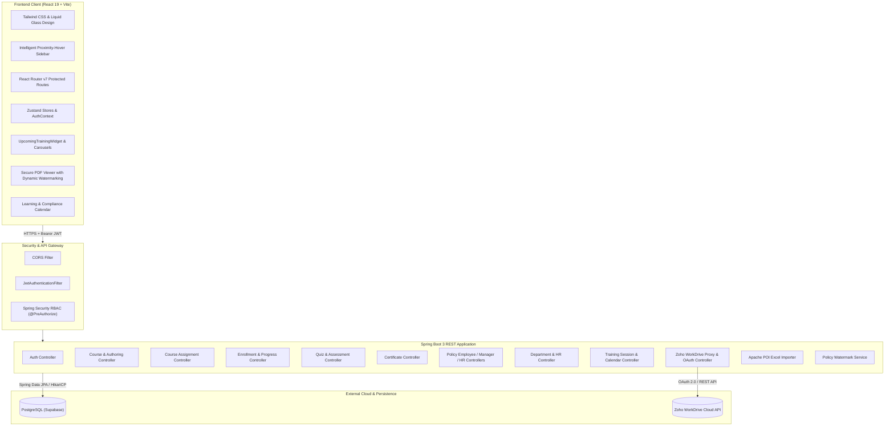

# Fairmacs Knowledge Management System (KMS)

**Fairmacs KMS** is a modern, enterprise-grade Knowledge Management System engineered specifically for corporate workforce training, role-based skill development, regulatory compliance auditing, corporate policy governance, and verifiable credentialing across global freight forwarding, shipping, and logistics operations.

Built on an asynchronous, decoupled architecture with a **React 19 + Vite** single-page application on the frontend and a **Spring Boot 3 + PostgreSQL (Supabase)** microservice-ready backend, featuring integrated cloud document storage via **Zoho WorkDrive OAuth 2.0** and dynamic confidential document watermarking.

---

## 📑 Table of Contents

- [Core Capabilities & Highlights](#-core-capabilities--highlights)
- [Role-Based Access Control (RBAC)](#-role-based-access-control-rbac)
- [System Architecture](#-system-architecture)
- [Technology Stack](#-technology-stack)
- [Project Directory Layout](#-project-directory-layout)
- [Security & Credential Management](#-security--credential-management)
- [Prerequisites](#-prerequisites)
- [Environment Configuration](#-environment-configuration)
  - [Backend Environment Variables](#backend-environment-variables)
  - [Frontend Environment Variables](#frontend-environment-variables)
- [Getting Started Locally](#-getting-started-locally)
  - [1. Backend Setup (Spring Boot)](#1-backend-setup-spring-boot)
  - [2. Frontend Setup (React + Vite)](#2-frontend-setup-react--vite)
- [Automated Verification & Test Suites](#-automated-verification--test-suites)
- [Complete REST API Reference](#-complete-rest-api-reference)
  - [1. Authentication & User Profile](#1-authentication--user-profile)
  - [2. Course Catalog & Curriculum](#2-course-catalog--curriculum)
  - [3. Course Drafts (Authoring in Progress)](#3-course-drafts-authoring-in-progress)
  - [4. Course Assignment Engine](#4-course-assignment-engine)
  - [5. Enrollments & Learning Progress](#5-enrollments--learning-progress)
  - [6. Quizzes & Assessments](#6-quizzes--assessments)
  - [7. Certificates & Verification](#7-certificates--verification)
  - [8. Corporate Policies & Agreements (Employee)](#8-corporate-policies--agreements-employee)
  - [9. Department Policies & Supervision (Manager)](#9-department-policies--supervision-manager)
  - [10. Enterprise Policy Governance (HR / Admin)](#10-enterprise-policy-governance-hr--admin)
  - [11. Department Management & Roster](#11-department-management--roster)
  - [12. HR Admin & Employee Directory](#12-hr-admin--employee-directory)
  - [13. Reports & Analytics](#13-reports--analytics)
  - [14. Learning & Compliance Calendar](#14-learning--compliance-calendar)
  - [15. Zoho WorkDrive Integration](#15-zoho-workdrive-integration)
- [Production Build & Deployment](#-production-build--deployment)
- [Security Auditing & Clean Git Policies](#-security-auditing--clean-git-policies)
- [License](#-license)

---

## 🚀 Core Capabilities & Highlights

### 1. 🎓 Course Authoring & Curriculum Wizard
- **Step-by-Step Course Builder Wizard**: Author courses through a polished Fairmacs blue glassmorphism wizard with cached reference data preloading.
- **Hierarchical Curriculum**: Partition courses into sequential Modules and Lessons with fine-grained sequencing controls.
- **Rich Media & Document Integration**: Embed video lectures (YouTube, MP4 streams) and cloud-hosted documents (PDF, DOCX) directly into lesson steps.
- **Multi-Module Draft Management**: Save multi-module drafts incrementally with auto-save before publishing to the active catalog.
- **Zoho WorkDrive Cloud Integration**: Seamlessly upload and stream training documents via enterprise Zoho WorkDrive folders.

### 2. 🎯 Course Assignment & Carousel Engine
- **Targeted Training Delivery**: Assign courses by **Department**, **Employee Group**, or **Individual Employees** with mandatory/elective designations.
- **Universal Assigned Learning Carousel**: Animated course carousel on the Employee, Manager, and HR/Admin dashboards displaying only courses assigned to the signed-in user, gracefully handling 0, 1, or N enrollments without blank spaces or loop errors.
- **Self-Paced Learning**: Employees can explore the catalog, self-enroll in electives, and monitor curriculum milestones.

### 3. 🧪 Server-Authoritative Assessments & Bulk Quiz Import
- **Anti-Cheat Server-Side Evaluation**: Quiz questions, answers, and scoring thresholds are securely evaluated on the backend.
- **Timed Attempts**: Configurable timers and attempt ceilings with automated result calculations.
- **Bulk Quiz Import (`.xlsx`)**: Rapidly import multi-question assessments using standardized Excel templates with automatic question parsing and validation.

### 4. 📜 Automated Verifiable PDF Certification
- **Dynamic PDF Certificate Generation**: Automatically generated upon course completion and passing score validation using OpenPDF.
- **Unique Verification Identifier**: Every certificate receives a tamper-resistant serial ID (e.g., `FM-CERT-2026-9516`).
- **Interactive Verification Registry**: Public and authenticated credential verification with live in-app preview.

### 5. 📑 Corporate Policies & SOP Agreements Module
- **End-to-End Acknowledgement Flow**: Distribute mandatory and recommended compliance policies with legal acknowledgement capture (IP address, user agent, timestamp).
- **Manager Policy Oversight (`/manager/policies`)**: Scoped departmental dashboard with overview metrics, document library, submission tracking, pending reminder dispatch, and Excel reports.
- **HR Policy Administration (`/hr/policies`)**: Centralized policy lifecycle management, batch department assignment, compliance audit tracking, automated reminders, and policy-wise Excel export.
- **Secure PDF Viewer with Dynamic Watermarking**: In-browser document viewer stamping dynamic rotated non-clipping watermarks (`PROPERTY OF FAIRMACS - CONFIDENTIAL`, employee name, ID, timestamp) using exact trigonometric bounding calculations across portrait, landscape, and custom page sizes.

### 6. 📅 Learning & Compliance Calendar
- **Multi-Source Event Aggregation**: Unifies scheduled live sessions (`/api/training-calendar`), assigned course deadlines, and policy acknowledgement deadlines into a single corporate calendar.
- **Strict Policy Due Date Rule**: Policies without due dates are strictly excluded from calendar events, preventing open-ended documents from displaying as overdue milestones.
- **Timezone-Safe Parsing**: Employs local date decomposition (`parseLocalDate`) to eliminate UTC midnight date-shifting across timezones.
- **Month, Week & Agenda Views**: Standardized desktop calendar with an Agenda view optimized for mobile devices.
- **Compact Dashboard Widget (`UpcomingTrainingWidget`)**: Embedded on the Employee, Manager, and HR/Admin dashboards with overdue prioritization and direct contextual actions (*Join*, *Continue*, *Review*).

### 7. 🏢 Departmental Training Analytics & Drilldown
- **Operational Progress Analytics**: Department completion rate calculated across active learners with assigned training, accurately distinguishing *"No Training Assigned"* from *"0% Needs Focus"*.
- **Fairmacs Blue Glassmorphism Drilldown Modal**: Portaled viewport modal (`createPortal` to `document.body`) completely immune to sticky header clipping or parent overflow boundaries, with direct *"Go to Courses"* navigation.

### 8. 👥 Workforce Lifecycle & Bulk Excel Import
- **Lifecycle Status Tracking**: Full lifecycle states (`ACTIVE`, `INACTIVE`, `ON_LEAVE`, `TERMINATED`).
- **Bulk Excel Import (`.xlsx`)**: High-performance batch onboarding powered by Apache POI with fuzzy column matching, automated validation, department assignment, and initial password generation.
- **Role Allocation**: Dynamically allocate and update employee roles (`EMPLOYEE`, `TRAINER`, `MANAGER`, `HR_ADMIN`, `SUPER_ADMIN`).

### 9. 🧭 Intelligent Hover-Based Proximity Sidebar
- **Proximity Detection**: Auto-hides by default and emerges smoothly when the cursor enters an 8–16px left-edge proximity threshold, with debounced retraction.
- **Liquid Glass Aesthetic**: Apple-inspired Liquid Glass material with specular highlights and fluid icon keyframe animations.
- **Body-Mounted Tooltip Portal**: Hover tooltips mount directly to `document.body`, ensuring 100% immunity to overflow clipping.
- **Dedicated HR Architecture**: 9 standalone dedicated HR administration routes (`/hr/overview`, `/hr/courses`, `/hr/drafts`, `/hr/employees`, `/hr/departments`, `/hr/certificates`, `/hr/policies`, `/hr/announcements`, `/hr/settings`).

---

## 👥 Role-Based Access Control (RBAC)

The system enforces strict Spring Security method-level authorization (`@PreAuthorize`) and frontend route guards across five distinct user roles:

| Capability / Resource | Employee | Trainer | Manager | HR Admin | Super Admin |
|---|:---:|:---:|:---:|:---:|:---:|
| Browse Public Course Catalog | ✅ | ✅ | ✅ | ✅ | ✅ |
| Track Personal Learning & Progress | ✅ | ✅ | ✅ | ✅ | ✅ |
| Take Quizzes & Download Certificates | ✅ | ✅ | ✅ | ✅ | ✅ |
| Acknowledge Corporate Policies | ✅ | ✅ | ✅ | ✅ | ✅ |
| Access In-App Notifications | ✅ | ✅ | ✅ | ✅ | ✅ |
| View Learning & Compliance Calendar | ✅ | ✅ | ✅ | ✅ | ✅ |
| Course Builder & Curriculum Authoring | ❌ | ✅ | ❌ | ✅ | ✅ |
| Manage Draft Courses | ❌ | ✅ | ❌ | ✅ | ✅ |
| Upload Course Documents to Zoho | ❌ | ✅ | ❌ | ✅ | ✅ |
| Manage Course Assignments | ❌ | ✅ | ❌ | ✅ | ✅ |
| View Team Transcripts & Progress | ❌ | ❌ | ✅ | ✅ | ✅ |
| Department Policy Supervision (`/manager/policies`) | ❌ | ❌ | ✅ | ❌ | ❌ |
| Verify Certificates in Registry | ❌ | ❌ | ✅ | ✅ | ✅ |
| Enterprise Policy Administration (`/hr/policies`) | ❌ | ❌ | ❌ | ✅ | ✅ |
| Department Management & Drilldowns | ❌ | ❌ | ❌ | ✅ | ✅ |
| Employee Directory & Profile Management | ❌ | ❌ | ❌ | ✅ | ✅ |
| Bulk Excel Employee Import (`.xlsx`) | ❌ | ❌ | ❌ | ✅ | ✅ |
| Connect / Manage Zoho WorkDrive OAuth | ❌ | ❌ | ❌ | ✅ | ✅ |
| Schedule Training Sessions & Deadlines | ❌ | ✅ | ✅ | ✅ | ✅ |
| Organization-Wide Audit & HR Analytics | ❌ | ❌ | ❌ | ✅ | ✅ |

---

## 🏗 System Architecture



---

## 🛠 Technology Stack

### Frontend Architecture
| Component | Technology | Version | Description |
|---|---|---|---|
| **Framework** | [React](https://react.dev/) | `19.2.8` | Component UI library |
| **Bundler & Server** | [Vite](https://vite.dev/) | `8.3.0` | Ultra-fast build tool and HMR dev server |
| **Routing** | [React Router](https://reactrouter.com/) | `7.x` | Client-side declarative routing and role guards |
| **State Management** | [Zustand](https://zustand.docs.pmnd.rs/) | `5.x` | Minimalist and fast centralized state management |
| **Styling** | [Tailwind CSS](https://tailwindcss.com/) | `4.x` | Utility-first styling framework |
| **Icons** | [Lucide React](https://lucide.dev/) | `1.47.0` | Modern, consistent enterprise icon library |
| **Spreadsheet Ingestion & Export** | [ExcelJS](https://github.com/exceljs/exceljs) | `4.4.0` | Client-side spreadsheet generation and exports |
| **PDF Rendering & Export** | [jsPDF](https://github.com/parallax/jsPDF) + AutoTable | `4.2.1` | In-browser PDF generation and table exports |
| **PDF Processing & Worker** | [pdfjs-dist](https://github.com/mozilla/pdf.js) | `6.5.438` | High-performance PDF parsing and canvas rendering |
| **Document Viewer** | [docx-preview](https://github.com/Volser/docx-preview) | `0.4.1` | Client-side DOCX rendering without server dependency |
| **Micro-Animations** | [canvas-confetti](https://www.npmjs.com/package/canvas-confetti) | `1.9.4` | Visual celebration upon course completion |
| **3D Rendering** | [Three.js](https://threejs.org/) | `0.187.0` | Maritime port backdrop visuals |

### Backend Architecture
| Component | Technology | Version | Description |
|---|---|---|---|
| **Runtime & Core** | [Java SE](https://adoptium.net/) | `17 LTS` | Modern Java platform |
| **Framework** | [Spring Boot](https://spring.io/projects/spring-boot) | `3.2.0` | Enterprise application framework |
| **Security** | Spring Security + [JJWT](https://github.com/jwtk/jjwt) | `0.12.3` | Stateless Bearer token authentication & authorization |
| **Database ORM** | Spring Data JPA / Hibernate | `6.x` | Relational data mapping and repository abstraction |
| **Database** | PostgreSQL ([Supabase](https://supabase.com/)) | `15+` | Enterprise-grade cloud relational database |
| **PDF Generation** | [OpenPDF](https://github.com/LibrePDF/OpenPDF) | `1.3.39` | High-fidelity server-side certificate rendering |
| **Excel Ingestion** | [Apache POI](https://poi.apache.org/) (poi-ooxml) | `5.4.1` | High-performance Excel (`.xlsx`) bulk employee and quiz parser |
| **HTTP Client** | Spring `RestTemplate` | `3.2.0` | Secure integration client for Zoho WorkDrive |
| **Build Tool** | Apache Maven | `3.8+` | Dependency management and build automation |

---

## 📁 Project Directory Layout

```
fairmacs-lms/
├── .gitignore                                 # Git rules (excludes secrets, uploads, dumps)
├── .env.example                               # Frontend environment template
├── README.md                                  # Complete project documentation
│
├── frontend/                                  # React 19 + Vite Application
│   ├── public/                                # Public assets & branding icons
│   ├── src/
│   │   ├── components/                        # Modular React views and widgets
│   │   │   ├── AssignedLearningCarousel.jsx   # Role-aware assigned course carousel
│   │   │   ├── CourseAssignmentModal.jsx      # Department & employee course assignment
│   │   │   ├── CourseBuilderModal.jsx         # Glassmorphism course authoring wizard
│   │   │   ├── CourseViewer.jsx               # Lesson player with secure PDF watermark
│   │   │   ├── DepartmentManagement.jsx       # Department list, metrics & actions
│   │   │   ├── HrAdminDashboard.jsx           # Redesigned HR/Admin operations workspace
│   │   │   ├── HrCoursesPage.jsx              # Dedicated HR assigned courses view
│   │   │   ├── HrDraftsPage.jsx               # Dedicated HR course drafts view
│   │   │   ├── HrCertificatesPage.jsx         # Dedicated HR certificate registry
│   │   │   ├── HrAnnouncementsPage.jsx        # Dedicated HR broadcast announcements
│   │   │   ├── HrSettingsPage.jsx             # Dedicated HR governance & settings
│   │   │   ├── ManagerDashboard.jsx           # Redesigned team supervision workspace
│   │   │   ├── Overview.jsx                   # Redesigned employee overview workspace
│   │   │   ├── TrainerDashboard.jsx           # Redesigned trainer authoring workspace
│   │   │   ├── TrainingCalendar.jsx           # Learning & Compliance Calendar (Month, Week, Agenda)
│   │   │   ├── dashboard/                     # Shared modular dashboard widgets
│   │   │   │   ├── UpcomingTrainingWidget.jsx # Compact unified training & deadlines widget
│   │   │   │   ├── LearningStreaks.jsx        # Activity consistency rings
│   │   │   │   ├── LearningProgress.jsx       # Curriculum snapshot and metric cards
│   │   │   │   ├── SmartLearningCard.jsx      # Priority-driven next-up action card
│   │   │   │   └── PoliciesWidget.jsx         # Overview policy acknowledgement widget
│   │   │   └── policies/                      # Corporate policies & agreements module
│   │   │       ├── PolicyHrManagement.jsx     # Centralized HR policy control hub
│   │   │       ├── PolicyPdfViewerModal.jsx   # Secure PDF viewer with dynamic watermark
│   │   │       └── manager/                   # Managerial policy supervision tabs
│   │   ├── context/
│   │   │   └── AuthContext.jsx                # User session, login, logout, password change
│   │   ├── services/                          # API clients (Fetch / authFetch abstractions)
│   │   │   ├── calendarService.js             # Unified calendar data pipeline & aggregation
│   │   │   ├── courseService.js               # Courses, authoring, and trainer insights
│   │   │   ├── hrAdminService.js              # HR and employee administrative calls
│   │   │   ├── policyService.js               # Policy retrieval, acknowledgement & exports
│   │   │   └── zohoService.js                 # Zoho WorkDrive connect & status APIs
│   │   ├── stores/                            # Zustand reactive stores
│   │   ├── utils/                             # Utility helpers & mathematical calculations
│   │   │   ├── watermarkUtil.js               # Rotated bounding-box watermark calculations
│   │   │   ├── deadlines.js                   # Timezone-safe deadline urgency evaluators
│   │   │   └── courseDuration.js              # Standardized course duration formatting
│   │   ├── App.jsx                            # Root layout, role routing & navigation
│   │   └── main.jsx                           # Application entry point
│   ├── package.json
│   └── vite.config.js
│
└── backend/                                   # Spring Boot 3 REST Application
    ├── pom.xml                                # Maven build specifications
    └── src/main/
        ├── java/com/fairmacs/lms/
        │   ├── config/                        # Spring configuration & data seeders
        │   ├── controller/                    # REST API Controllers
        │   │   ├── AuthController.java
        │   │   ├── CertificateController.java
        │   │   ├── CourseAssignmentController.java
        │   │   ├── CourseController.java
        │   │   ├── DepartmentController.java
        │   │   ├── DraftController.java
        │   │   ├── EnrollmentController.java
        │   │   ├── HrAdminController.java
        │   │   ├── PolicyEmployeeController.java
        │   │   ├── PolicyHrController.java
        │   │   ├── PolicyManagerController.java
        │   │   ├── QuizController.java
        │   │   ├── TrainerReportController.java
        │   │   ├── TrainingSessionController.java
        │   │   └── ZohoOAuthController.java
        │   ├── dto/                           # Data Transfer Objects
        │   ├── entity/                        # JPA Database Entities
        │   │   ├── PolicyDocument.java
        │   │   ├── PolicyAssignment.java
        │   │   ├── PolicyAcknowledgement.java
        │   │   ├── Course.java
        │   │   ├── Enrollment.java
        │   │   ├── User.java
        │   │   └── ...
        │   ├── integration/zoho/              # Zoho WorkDrive Cloud Integration
        │   ├── repository/                    # Spring Data JPA Repositories
        │   ├── security/                      # JWT authentication & Spring Security
        │   └── service/                       # Business Logic Layer
        │       ├── PolicyService.java
        │       ├── PolicyWatermarkService.java
        │       ├── CourseAuthoringService.java
        │       ├── EnrollmentService.java
        │       ├── HrAdminService.java
        │       ├── ManagerReportService.java
        │       └── TrainingSessionService.java
        └── resources/
            ├── application.properties         # Environment-driven configuration
            └── application.properties.example # Documented template for setup
```

---

## 🔐 Security & Credential Management

Fairmacs KMS is architected under strict **Zero-Credential-in-Code** principles:

1. **Pure Environment Variable Injection**: No database credentials, API keys, client secrets, or cryptographic tokens are ever committed to the repository.
2. **Local Configuration Decoupling**: Developers can optionally use `application-local.properties` (strictly ignored by Git) to override local settings without risking accidental commits.
3. **AES-256 Cloud Token Encryption**: Zoho OAuth refresh tokens are encrypted using AES-GCM-256 before being stored in the database.
4. **BCrypt Password Security**: All employee passwords are salted and hashed using BCrypt. The system never stores or transmits plaintext passwords.
5. **Stateless JWT Authorization**: Requests are secured via signed HMAC-SHA-256 JSON Web Tokens with strict expiry checks and user status verification.
6. **Dynamic Non-Clipping Watermarking**: Confidential course materials and corporate policies are dynamically watermarked in-browser and server-side with verified employee credentials and timestamps to prevent unauthorized leaks.

---

## 📋 Prerequisites

Before running the application, make sure the following dependencies are installed on your workstation:

| Prerequisite | Minimum Version | Installation Link |
|---|---|---|
| **Java Development Kit (JDK)** | Java 17 LTS | [Eclipse Temurin](https://adoptium.net/) |
| **Node.js & npm** | Node.js v18+ & npm v9+ | [Node.js Official](https://nodejs.org/) |
| **Apache Maven** | Maven 3.8+ | [Apache Maven](https://maven.apache.org/) (or use `mvnw`) |
| **PostgreSQL Database** | PostgreSQL 14+ | Local instance or [Supabase](https://supabase.com/) |

---

## ⚙️ Environment Configuration

### Backend Environment Variables

Configure the following environment variables on your system, or supply them in a private `backend/src/main/resources/application-local.properties` file:

| Variable | Description | Required | Example Value |
|---|---|:---:|---|
| `SUPABASE_DB_URL` | JDBC Connection URL to PostgreSQL | **Yes** | `jdbc:postgresql://db.xxxx.supabase.co:5432/postgres?sslmode=require` |
| `SUPABASE_DB_USERNAME` | Database username | **Yes** | `postgres` |
| `SUPABASE_DB_PASSWORD` | Database password | **Yes** | `YourSecretPasswordHere` |
| `JWT_SECRET` | 256-bit secret key for HMAC SHA JWT | **Yes** | `404E635266556A586E3272357538782F413F4428472B4B6250645367566B5970` |
| `ZOHO_CLIENT_ID` | Zoho WorkDrive API Client ID | Optional | `1000.XXXXXXXXXXXXXXXXXXXXXXXXXXXXXX` |
| `ZOHO_CLIENT_SECRET` | Zoho WorkDrive API Client Secret | Optional | `xxxxxxxxxxxxxxxxxxxxxxxxxxxxxxxx` |
| `ZOHO_REDIRECT_URI` | Zoho OAuth 2.0 Redirect URI | Optional | `http://localhost:8080/api/integrations/zoho/callback` |
| `ZOHO_TOKEN_ENCRYPTION_KEY` | 32-byte Base64 AES key for OAuth tokens | Optional | `k8yW5f8f9Q3b4+6fX+7t8Y8Z...` |
| `ZOHO_COURSE_DOCUMENTS_FOLDER_ID` | Target folder ID in Zoho WorkDrive | Optional | `uqi2q368e8c06e5bc44de87954550476aa546` |
| `server.port` / `PORT` | Spring Boot HTTP port (Render injects `$PORT`) | No | `8080` (default) |

> A ready-to-use template is available at [`backend/src/main/resources/application.properties.example`](backend/src/main/resources/application.properties.example).

### Frontend Environment Variables

Create a file named `.env` in the `frontend/` folder (or copy from `.env.example`):

```env
VITE_API_BASE_URL=http://localhost:8080/api
```

---

## 🚀 Getting Started Locally

### 1. Backend Setup (Spring Boot)

1. Navigate to the backend directory:
   ```bash
   cd backend
   ```

2. Export your environment variables:

   **Windows (PowerShell)**:
   ```powershell
   $env:SUPABASE_DB_URL="jdbc:postgresql://<host>:5432/<database>?sslmode=require"
   $env:SUPABASE_DB_USERNAME="postgres"
   $env:SUPABASE_DB_PASSWORD="<your_secure_password>"
   $env:JWT_SECRET="<your_jwt_secret_min_256_bits>"
   $env:ZOHO_CLIENT_ID="<your_zoho_client_id>"
   $env:ZOHO_CLIENT_SECRET="<your_zoho_client_secret>"
   $env:ZOHO_TOKEN_ENCRYPTION_KEY="<base64_encoded_32_byte_aes_key>"
   ```

   **macOS / Linux (Bash / Zsh)**:
   ```bash
   export SUPABASE_DB_URL="jdbc:postgresql://<host>:5432/<database>?sslmode=require"
   export SUPABASE_DB_USERNAME="postgres"
   export SUPABASE_DB_PASSWORD="<your_secure_password>"
   export JWT_SECRET="<your_jwt_secret_min_256_bits>"
   export ZOHO_CLIENT_ID="<your_zoho_client_id>"
   export ZOHO_CLIENT_SECRET="<your_zoho_client_secret>"
   export ZOHO_TOKEN_ENCRYPTION_KEY="<base64_encoded_32_byte_aes_key>"
   ```

3. Compile and start the backend service:
   ```bash
   mvn spring-boot:run
   ```
   *The backend will boot up at `http://localhost:8080`.*

---

### 2. Frontend Setup (React + Vite)

1. In a separate terminal, navigate to the frontend directory:
   ```bash
   cd frontend
   ```

2. Install all required dependencies:
   ```bash
   npm install
   ```

3. Launch the Vite development server:
   ```bash
   npm run dev
   ```

4. Open your web browser and navigate to:
   ```
   http://localhost:5173
   ```

---

### 3. Docker & Cloud Deployment (Render Blueprint)

Fairmacs KMS includes an infrastructure-as-code deployment blueprint via [`render.yaml`](render.yaml) and a hardened multi-stage [`backend/Dockerfile`](backend/Dockerfile):

#### Run via Docker Locally:
```bash
# Build the backend image
docker build -t fairmacs-lms-backend backend/

# Run container with dynamic port and memory constraints
docker run -p 8080:8080 \
  -e SUPABASE_DB_URL="jdbc:postgresql://<host>:5432/<database>?sslmode=require" \
  -e SUPABASE_DB_USERNAME="postgres" \
  -e SUPABASE_DB_PASSWORD="<password>" \
  -e JWT_SECRET="<secret>" \
  -e PORT=8080 \
  fairmacs-lms-backend
```

#### Deploy to Render:
1. Connect the GitHub repository to **Render**.
2. Render detects [`render.yaml`](render.yaml) automatically and provisions:
   - `fairmacs-lms-api`: Docker web service with Java 17, non-root execution (`UID 1001`), and memory constraints (`-XX:MaxRAMPercentage=70 -XX:+UseSerialGC -Xss512k`).
   - `fairmacs-lms-web`: Static web service running Node 22 (`npm ci && npm run build`), publishing `dist`, with SPA rewrite rule (`/* -> /index.html`).
3. Set your private environment variables in the Render dashboard (`SUPABASE_DB_URL`, `SUPABASE_DB_PASSWORD`, `CORS_ALLOWED_ORIGINS`). `JWT_SECRET` is generated automatically.

---

## 🧪 Automated Verification & Test Suites

Fairmacs KMS includes **23 comprehensive automated verification suites** covering architecture, security, routing, calculations, and visual regression prevention:

```bash
# Run all 23 frontend test suites sequentially
npm --prefix frontend test
```

### Test Suite Directory
1. `test-roadmap-smoke.js`: Smoke test verifying API URLs, cleanup, import templates, and password modal sync.
2. `test-hr-routes-navigation.js`: Dedicated HR routes (`/hr/*`), removal of monolithic sub-tabs, and sidebar wiring.
3. `test-intelligent-hover-sidebar.js`: 8–16px edge proximity detection, body-mounted tooltip portals, and keyboard accessibility.
4. `test-assigned-learning-redesign.js`: Employee learning snapshot, urgency calculation, and smart learning cards.
5. `test-create-course-modal-positioning.js`: Course authoring modal rendering and reference caching.
6. `test-course-overview-system-replacement.js`: Full course overview replacements and lesson progress flows.
7. `test-hero-thumbnail-visibility-scenarios.js`: Course thumbnail loading, fallback states, and aspect-ratio preservation.
8. `test-phase1-course-carousel-fix.js`: Single-course and multi-course carousel rendering without duplication.
9. `test-phase2-course-carousel-refinement.js`: Carousel navigation buttons, looping physics, and touch dragging.
10. `test-phase3-assigned-course-sync.js`: Real-time cross-tab course assignment synchronization (`lms:enrollment-updated`).
11. `test-phase4-course-overview-navigation.js`: Deep linking into lesson players with active lesson tracking.
12. `test-phase5-cross-module-integration.js`: Certificates, policies, announcements, and progress hub integration.
13. `test-stage4-manager-policies.js`: Manager policy tabs, submission modals, and department-scoped reports.
14. `test-stage5-employee-policies.js`: Employee policy assignment filtering (`ALL`, `PENDING`, `ACKNOWLEDGED`, `OVERDUE`).
15. `test-stage6-secure-viewer-acknowledgement.js`: Secure PDF viewer, legal declaration capture, and download permissions.
16. `test-stage7-policy-automations.js`: Automated overdue reminders, batch notifications, and compliance alerts.
17. `test-stage8-reports-tracking.js`: Departmental compliance audits, export generation, and progress indicators.
18. `test-policy-wise-excel-export.js`: Policy-wise spreadsheet export with employee status and acknowledgement dates.
19. `test-course-document-watermark.js`: Confidential watermark presence on course PDF materials.
20. `test-watermark-clipping-fix.js`: Exact mathematical non-clipping rotated bounding-box verification across page geometries.
21. `test-dynamic-sidebar-behaviour.js`: Dynamic role-based navigation mapping and active state resolution.
22. `test-hr-manager-courses-carousel.js`: HR and Manager assigned course carousels handling 0, 1, or N courses.
23. `test-learning-compliance-calendar.js`: Multi-source calendar pipeline, strict policy due date rule, and `UpcomingTrainingWidget`.

---

## 📡 Complete REST API Reference

All backend endpoints are prefixed with `/api`. Protected routes require a Bearer token in the request header:
`Authorization: Bearer <jwt-token>`

### 1. Authentication & User Profile
| Method | Endpoint | Access | Description |
|---|---|---|---|
| `POST` | `/api/auth/login` | Public | Authenticate credentials and receive JWT |
| `GET` | `/api/auth/me` | Authenticated | Retrieve authenticated user profile |
| `POST` | `/api/auth/change-password` | Authenticated | Change user password with BCrypt verification |
| `POST` | `/api/auth/verify-password` | Authenticated | Verify existing password validity |

### 2. Course Catalog & Curriculum
| Method | Endpoint | Access | Description |
|---|---|---|---|
| `GET` | `/api/courses` | Authenticated | List all active published courses |
| `GET` | `/api/courses/{id}` | Authenticated | Retrieve full course details with modules and lessons |
| `POST` | `/api/courses/authoring/create` | Trainer, HR Admin | Create and publish a new course with curriculum |
| `PUT` | `/api/courses/authoring/{id}` | Trainer, HR Admin | Update an existing course and its curriculum |
| `DELETE` | `/api/courses/authoring/{id}` | Trainer, HR Admin | Delete a course and all associated modules |

### 3. Course Drafts (Authoring in Progress)
| Method | Endpoint | Access | Description |
|---|---|---|---|
| `GET` | `/api/courses/drafts` | Trainer, HR Admin | List all saved course drafts |
| `POST` | `/api/courses/drafts` | Trainer, HR Admin | Save or update a course draft |
| `GET` | `/api/courses/drafts/{id}` | Trainer, HR Admin | Load a saved draft by ID |
| `DELETE` | `/api/courses/drafts/{id}` | Trainer, HR Admin | Discard a draft |

### 4. Course Assignment Engine
| Method | Endpoint | Access | Description |
|---|---|---|---|
| `POST` | `/api/course-assignments/department` | Trainer, HR Admin | Assign a course to an entire department |
| `POST` | `/api/course-assignments/employees` | Trainer, HR Admin | Assign a course to specific individual employees |

### 5. Enrollments & Learning Progress
| Method | Endpoint | Access | Description |
|---|---|---|---|
| `POST` | `/api/enrollments/enroll/{courseId}` | Authenticated | Enroll current user in a course |
| `GET` | `/api/enrollments/my-learning` | Authenticated | Get current user's enrolled courses and completion metrics |
| `GET` | `/api/enrollments/course/{courseId}/status` | Authenticated | Check user enrollment status for a specific course |
| `POST` | `/api/lesson-progress/toggle` | Authenticated | Toggle lesson completion state |
| `GET` | `/api/lesson-progress/course/{courseId}` | Authenticated | Fetch completed lesson IDs for a course |

### 6. Quizzes & Assessments
| Method | Endpoint | Access | Description |
|---|---|---|---|
| `GET` | `/api/quizzes/course/{courseId}` | Authenticated | Get quiz definition and questions for a course |
| `POST` | `/api/quizzes/{quizId}/start` | Authenticated | Start a timed quiz attempt |
| `GET` | `/api/quizzes/{quizId}/unlock-status` | Authenticated | Check if quiz is unlocked for the user |
| `POST` | `/api/quizzes/submit` | Authenticated | Submit answers and receive server-evaluated score |
| `GET` | `/api/quizzes/attempt/{attemptId}/result` | Authenticated | Retrieve score details for a completed attempt |
| `POST` | `/api/quizzes/import` | Trainer, HR Admin | Bulk import quiz questions via Excel (`.xlsx`) |

### 7. Certificates & Verification
| Method | Endpoint | Access | Description |
|---|---|---|---|
| `GET` | `/api/certificates/my-certificates` | Authenticated | List all certificates earned by the current user |
| `GET` | `/api/certificates/{id}/download` | Authenticated | Download the official generated PDF certificate |
| `GET` | `/api/certificates/verify/{certificateNumber}` | Public | Publicly verify certificate authenticity by serial number |
| `GET` | `/api/certificates/recent` | Manager, HR Admin | View recently issued certificates across the organization |

### 8. Corporate Policies & Agreements (Employee)
| Method | Endpoint | Access | Description |
|---|---|---|---|
| `GET` | `/api/policies/categories` | Authenticated | List active corporate policy categories |
| `GET` | `/api/policies/my-assignments` | Authenticated | Fetch user's assigned policies (`ALL`, `PENDING`, `ACKNOWLEDGED`, `OVERDUE`) |
| `GET` | `/api/policies/assignments/{id}` | Authenticated | Fetch specific policy assignment metadata |
| `POST` | `/api/policies/assignments/{id}/acknowledge` | Authenticated | Legally acknowledge a policy with IP and timestamp capture |
| `GET` | `/api/policies/{id}/download` | Authenticated | Download policy document PDF (if download permitted) |
| `GET` | `/api/policies/{id}/stream` | Authenticated | Stream policy PDF document for secure browser viewing |

### 9. Department Policies & Supervision (Manager)
| Method | Endpoint | Access | Description |
|---|---|---|---|
| `GET` | `/api/manager/policies/overview` | Manager | Scoped departmental policy compliance metrics |
| `GET` | `/api/manager/policies/departments` | Manager | List department branches supervised by the manager |
| `GET` | `/api/manager/policies` | Manager | List active policies assigned to the manager's team |
| `POST` | `/api/manager/policies` | Manager | Propose / submit a new departmental SOP or policy document |
| `GET` | `/api/manager/policies/submissions` | Manager | List departmental policy submissions and review status |
| `GET` | `/api/manager/policies/reports` | Manager | Detailed employee policy acknowledgement status report |
| `GET` | `/api/manager/policies/reports/excel` | Manager | Export departmental policy report to Excel (`.xlsx`) |
| `POST` | `/api/manager/policies/remind/{assignmentId}` | Manager | Send acknowledgement reminder for an overdue policy |

### 10. Enterprise Policy Governance (HR / Admin)
| Method | Endpoint | Access | Description |
|---|---|---|---|
| `GET` | `/api/hr/policies` | HR Admin, Super Admin | List all company policies with category and status filters |
| `POST` | `/api/hr/policies` | HR Admin, Super Admin | Upload and publish a new enterprise policy document |
| `PUT` | `/api/hr/policies/{id}` | HR Admin, Super Admin | Update policy metadata and document parameters |
| `DELETE` | `/api/hr/policies/{id}` | HR Admin, Super Admin | Archive or delete a policy document |
| `POST` | `/api/hr/policies/{id}/assign` | HR Admin, Super Admin | Assign policy to all employees or specific departments |
| `GET` | `/api/hr/policies/overview` | HR Admin, Super Admin | Enterprise policy compliance rates and benchmark overview |
| `GET` | `/api/hr/policies/reports` | HR Admin, Super Admin | Comprehensive organization-wide acknowledgement audit report |
| `GET` | `/api/hr/policies/reports/excel` | HR Admin, Super Admin | Export full policy compliance audit report to Excel (`.xlsx`) |
| `GET` | `/api/hr/policies/reports/policy-wise/excel` | HR Admin, Super Admin | Export policy-by-policy compliance breakdown to Excel |
| `POST` | `/api/hr/policies/remind/{assignmentId}` | HR Admin, Super Admin | Send targeted policy reminder to a specific employee |
| `POST` | `/api/hr/policies/remind-all-overdue` | HR Admin, Super Admin | Batch send reminders to all overdue policy assignees |

### 11. Department Management & Roster
| Method | Endpoint | Access | Description |
|---|---|---|---|
| `GET` | `/api/departments` | Authenticated | List all departments with manager & headcount metrics |
| `GET` | `/api/departments/{id}` | Authenticated | Get specific department details |
| `GET` | `/api/departments/{id}/summary` | Authenticated | Summary of department course completion |
| `GET` | `/api/departments/{id}/courses` | Authenticated | Department courses and assigned training roster |
| `GET` | `/api/departments/{id}/courses/{courseId}/employees` | HR Admin | Matrix of employees enrolled in a course |

### 12. HR Admin & Employee Directory
| Method | Endpoint | Access | Description |
|---|---|---|---|
| `GET` | `/api/hr/employees` | HR Admin, Trainer | List and search all company employees |
| `POST` | `/api/hr/employees` | HR Admin | Create a new employee profile |
| `PUT` | `/api/hr/employees/{id}` | HR Admin | Update employee profile details |
| `PATCH` | `/api/hr/employees/{id}/status` | HR Admin | Update employee status (`ACTIVE`, `INACTIVE`, etc.) |
| `POST` | `/api/hr/employees/{id}/reset-password` | HR Admin | Reset an employee's password |
| `POST` | `/api/hr/employees/import` | HR Admin | Bulk import employees from an Excel file (`.xlsx`) |
| `GET` | `/api/hr/employees/import-template` | HR Admin | Download official Excel employee onboarding template |
| `GET` | `/api/hr/dashboard/metrics` | HR Admin | Live organization KPI metrics and department statistics |

### 13. Reports & Analytics
| Method | Endpoint | Access | Description |
|---|---|---|---|
| `GET` | `/api/reports/hr/summary` | HR Admin | Organization-wide compliance and completion rates |
| `GET` | `/api/reports/hr/department-compliance` | HR Admin | Department-by-department compliance comparison |
| `GET` | `/api/reports/hr/overdue` | HR Admin | Overdue mandatory training records |
| `GET` | `/api/reports/manager/team` | Manager, HR Admin | Team performance report for direct reports |
| `GET` | `/api/manager/reports/{managerId}` | Manager, HR Admin | Manager team report with employee status breakdown |
| `GET` | `/api/manager/reports/employee/{userId}` | Manager, HR Admin | Full training transcript for a team member |
| `GET` | `/api/trainer/insights` | Trainer, HR Admin | Trainer KPIs, enrollment counts, and course breakdowns |

### 14. Learning & Compliance Calendar
| Method | Endpoint | Access | Description |
|---|---|---|---|
| `GET` | `/api/training-calendar` | Authenticated | Retrieve live sessions, workshops, and webinars |
| `POST` | `/api/training-sessions` | Trainer, Manager, HR | Schedule a new live training session or workshop |
| `DELETE` | `/api/training-sessions/{id}` | Trainer, Manager, HR | Cancel a scheduled training session |
| `GET` | `/api/training-sessions/employees` | Authenticated | List selectable employees for session invitations |

### 15. Zoho WorkDrive Integration
| Method | Endpoint | Access | Description |
|---|---|---|---|
| `GET` | `/api/integrations/zoho/connect-url` | HR Admin | Generate OAuth 2.0 authorization URL for Zoho |
| `GET` | `/api/integrations/zoho/callback` | Public (OAuth) | Zoho OAuth 2.0 authorization code callback |
| `GET` | `/api/integrations/zoho/status` | Authenticated | Check if Zoho WorkDrive integration is active |
| `POST` | `/api/integrations/zoho/documents/upload` | Trainer, HR Admin | Upload course document (PDF/DOCX) to WorkDrive |
| `POST` | `/api/integrations/zoho/documents/attach-to-lesson` | HR Admin | Associate an uploaded WorkDrive file with a lesson |
| `GET` | `/api/lessons/{lessonId}/document` | Authenticated | Fetch download metadata for a lesson's document |
| `GET` | `/api/lessons/{lessonId}/document/stream` | Authenticated | Securely stream the lesson document from WorkDrive |

---

## 📦 Production Build & Deployment

### 1. Build Frontend Production Bundle
```bash
cd frontend
npm run build
```
The optimized client bundle will be generated in `frontend/dist/`. It can be served via NGINX, Cloudflare Pages, AWS S3/CloudFront, or any static file server.

To preview the built production bundle locally:
```bash
npm run preview
```

### 2. Build Backend Executable JAR
```bash
cd backend
mvn clean package -DskipTests
```
The self-contained executable JAR file will be produced in:
```
backend/target/fairmacs-lms-backend-1.0.0.jar
```

To run the production application:
```bash
java -jar -Dspring.profiles.active=prod backend/target/fairmacs-lms-backend-1.0.0.jar
```

---

## 🛡️ Security Auditing & Clean Git Policies

Before every Git commit and push, verify that no credentials or sensitive artifacts are staged:

- **No Hardcoded Passwords**: All DB connections use `${SUPABASE_DB_URL}`, `${SUPABASE_DB_USERNAME}`, and `${SUPABASE_DB_PASSWORD}`.
- **No Hardcoded API Keys or Secrets**: All OAuth and JWT configurations use `${JWT_SECRET}`, `${ZOHO_CLIENT_ID}`, and `${ZOHO_CLIENT_SECRET}`.
- **Ignored Dumps and Binary Backups**: All database dumps (`*.dump`, `*.sql`), certificates (`backend/uploads/`), and build artifacts are strictly excluded by `.gitignore`.
- **Pre-Push Validation**:
  ```bash
  # Verify working tree and ignored files
  git status
  ```

---

## 📄 License

Proprietary enterprise software developed for **Fairmacs**. All rights reserved. Unauthorized copying, distribution, or deployment of this software via any medium is strictly prohibited.
