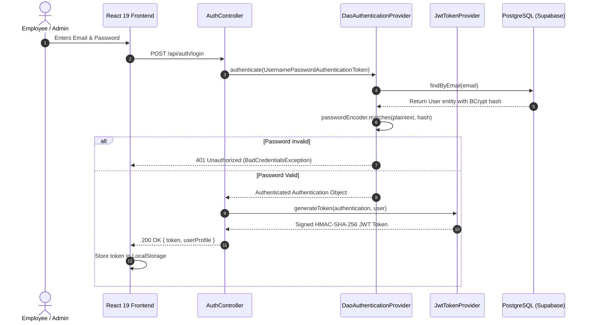
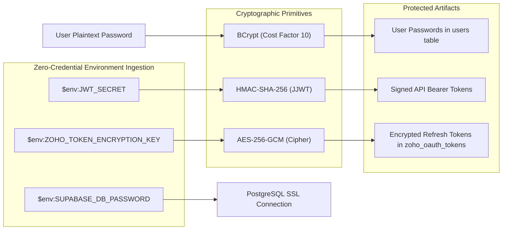

# Fairmacs KMS — Security Architecture Blueprint

**Document Reference:** SEC-ARCH-v1.0  
**Classification:** Enterprise Security Architecture Specification  
**Architecture Style:** Layered Microservice-Ready Architecture with Defense-in-Depth  
**Target Systems:** Spring Boot 3.2.0, React 19, Supabase PostgreSQL, Zoho WorkDrive Cloud

---

## 📑 Table of Contents
1. [Architectural Security Principles](#1-architectural-security-principles)
2. [Trust Zones & Network Security Perimeters](#2-trust-zones--network-security-perimeters)
3. [Identity & Access Management (IAM) Architecture](#3-identity--access-management-iam-architecture)
4. [Role-Based Access Control (RBAC) Subsystem](#4-role-based-access-control-rbac-subsystem)
5. [Cryptographic Subsystem & Secret Management](#5-cryptographic-subsystem--secret-management)
6. [Cloud Integration & Document Streaming Security](#6-cloud-integration--document-streaming-security)
7. [Digital Certificate Generation & Verification Subsystem](#7-digital-certificate-generation--verification-subsystem)
8. [Data Ingestion & Spreadsheet Processing Pipeline](#8-data-ingestion--spreadsheet-processing-pipeline)
9. [Transport Security & CORS Hardening](#9-transport-security--cors-hardening)

---

## 1. Architectural Security Principles

The security architecture of **Fairmacs KMS** is founded upon core defensive engineering principles:

- **Defense in Depth:** Multi-layered security controls implemented at the network layer, HTTP gateway, filter chain, business service layer, and database layer. A failure in one layer does not compromise the system.
- **Principle of Least Privilege (PoLP):** Users, controllers, and services operate with only the minimum privileges required to perform their functions.
- **Zero Trust Stance:** Network location within an intranet does not confer trust. Every API call must independently authenticate via a signed Bearer JWT and prove authorization.
- **Default Deny:** Ingress requests are denied access unless explicitly whitelisted in `SecurityConfig.java`.
- **Fail Securely:** Exceptions during authentication, authorization, or third-party cloud communication fail closed, preventing partially executed privileged actions.

---

## 2. Trust Zones & Network Security Perimeters

```mermaid
flowchart TD
    subgraph Zone1["Zone 1: Untrusted Public Network"]
        ClientBrowser["React 19 Client (Browser)"]
        ExternalAuditor["External Public Auditor"]
    end

    subgraph Zone2["Zone 2: Ingress & Edge Boundary (DMZ)"]
        TLS["TLS 1.3 Termination"]
        CORS["CORS Policy Gate"]
    end

    subgraph Zone3["Zone 3: Spring Security Perimeter"]
        JWTFilter["JwtAuthenticationFilter"]
        AuthManager["DaoAuthenticationProvider"]
        SecContext["SecurityContext (Current Thread)"]
    end

    subgraph Zone4["Zone 4: Trusted Application Core"]
        Controllers["REST Controllers (@PreAuthorize)"]
        Services["Domain Services (Course, Quiz, HR, POI)"]
        CryptoEngine["AES-256-GCM / BCrypt Engine"]
    end

    subgraph Zone5["Zone 5: Dedicated Data Store (Supabase)"]
        Postgres[(PostgreSQL with SSL)]
    end

    subgraph Zone6["Zone 6: External Cloud SaaS (Zoho)"]
        ZohoWorkDrive[(Zoho WorkDrive API)]
    end

    ClientBrowser -->|HTTPS / Bearer JWT| TLS
    ExternalAuditor -->|HTTPS / Public Verify| TLS
    TLS --> CORS
    CORS --> JWTFilter
    JWTFilter --> AuthManager
    AuthManager --> SecContext
    SecContext --> Controllers
    Controllers --> Services
    Services --> CryptoEngine
    Services -->|JDBC SSL (HikariCP)| Postgres
    Services -->|OAuth 2.0 Authenticated HTTP| ZohoWorkDrive
```

---

## 3. Identity & Access Management (IAM) Architecture

### 3.1 Authentication Workflow



### 3.2 JWT Token Architecture
Tokens generated by `JwtTokenProvider.java` adhere to RFC 7519 specifications:

- **Algorithm Header:** `{"alg": "HS256", "typ": "JWT"}`
- **Claims Payload:**
  - `sub`: User email (Principal identifier).
  - `userId`: Numeric internal user database ID (`Long`).
  - `role`: Granted authority (e.g., `ROLE_HR_ADMIN`, `ROLE_EMPLOYEE`).
  - `department`: Departmental affiliation for data segregation.
  - `iat`: Token issuance timestamp (`Instant.now()`).
  - `exp`: Token expiry timestamp (`iat + 86,400,000 ms`).
- **Signature:** Cryptographically signed using HMAC-SHA-256 with the system secret key (`JWT_SECRET`).

### 3.3 Request Interception & Validation Pipeline
Every incoming HTTP request passing through `JwtAuthenticationFilter.java` executes:
1. Extraction of `Bearer <token>` from HTTP `Authorization` header.
2. Cryptographic signature and expiration verification against `JWT_SECRET`.
3. Account lifecycle validation: Ensures the user exists in database and is **not** flagged as `INACTIVE` or `TERMINATED`.
4. Hydration of `SecurityContextHolder` with `CurrentJwtClaims` details and Spring Security `GrantedAuthority` records.

---

## 4. Role-Based Access Control (RBAC) Subsystem

Fairmacs KMS implements declarative method-level security enabled via `@EnableMethodSecurity(prePostEnabled = true)`:

```
                          +------------------------+
                          |   ROLE_HR_ADMIN        | (Highest Authority)
                          +-----------+------------+
                                      |
                     +----------------+----------------+
                     |                                 |
         +-----------v------------+        +-----------v------------+
         |      ROLE_TRAINER      |        |      ROLE_MANAGER      |
         +-----------+------------+        +-----------+------------+
                     |                                 |
                     +----------------+----------------+
                                      |
                          +-----------v------------+
                          |     ROLE_EMPLOYEE      | (Base Learner)
                          +------------------------+
```

### Authorization Enforcement Matrix
| Role | Endpoints Authorized | Key Method Annotations |
|---|---|---|
| `ROLE_HR_ADMIN` | Department setup, employee CRUD, Excel imports, global training assignments, system audits. | `@PreAuthorize("hasRole('HR_ADMIN')")` |
| `ROLE_TRAINER` | Course authoring, module & lesson builder, draft publishing, quiz creation. | `@PreAuthorize("hasAnyRole('TRAINER', 'HR_ADMIN')")` |
| `ROLE_MANAGER` | Team compliance reporting, direct report training transcripts, departmental catalogs. | `@PreAuthorize("hasAnyRole('MANAGER', 'HR_ADMIN')")` |
| `ROLE_EMPLOYEE` | Catalog browsing, self-enrollment, lesson progress tracking, taking quizzes, downloading earned certificates. | `@PreAuthorize("isAuthenticated()")` |

### Horizontal Data Segregation (IDOR Prevention)
To prevent Insecure Direct Object Reference (IDOR) attacks:
- `SecurityContextUtil.getCurrentUserId()` retrieves the caller's verified database ID from the security context.
- Manager endpoints verify that the requested employee belongs to the manager's reporting line before returning transcripts.

---

## 5. Cryptographic Subsystem & Secret Management



### 5.1 Password Hashing Architecture
- Implemented via `BCryptPasswordEncoder`.
- Generates a unique 128-bit salt per user automatically.
- Computation cost factor `10` ensures resilience against hardware brute-force and rainbow table attacks.

### 5.2 Zoho OAuth Token Encryption at Rest
Zoho OAuth refresh tokens grant ongoing access to cloud files. In `ZohoOAuthService.java`, refresh tokens are encrypted using **AES-256-GCM (Galois/Counter Mode)**:
- **Cipher:** `AES/GCM/NoPadding`
- **Key:** 256-bit AES key decoded from Base64 environment variable `ZOHO_TOKEN_ENCRYPTION_KEY`.
- **IV:** Dynamically generated 12-byte cryptographically secure random Initialization Vector (`SecureRandom`).
- **Tag:** 128-bit GCM authentication tag guarantees ciphertext integrity against tampering.
- Stored as `Base64(IV + CipherText)` in the `zoho_oauth_tokens` table.

---

## 6. Cloud Integration & Document Streaming Security

```mermaid
sequenceDiagram
    autonumber
    actor Learner as Authenticated Learner
    participant Client as React 19 Frontend
    participant DocCtrl as LessonDocumentController
    participant ZohoService as ZohoWorkDriveDownloadService
    participant OAuthService as ZohoOAuthService
    participant Zoho as Zoho WorkDrive Cloud

    Learner->>Client: Clicks "View Lesson PDF"
    Client->>DocCtrl: GET /api/lessons/{id}/document/stream (Bearer JWT)
    DocCtrl->>DocCtrl: Verify enrollment & course publication
    DocCtrl->>ZohoService: downloadDocument(workdriveFileId)
    ZohoService->>OAuthService: getAccessToken()
    OAuthService->>OAuthService: Check expiry; refresh via AES-decrypted token if needed
    OAuthService-->>ZohoService: Valid Zoho Access Token
    ZohoService->>Zoho: GET /download/{fileId} (Header: Zoho-oauthtoken)
    Zoho-->>ZohoService: Binary Document Stream (PDF/DOCX)
    ZohoService-->>DocCtrl: ResponseEntity<Resource>
    DocCtrl-->>Client: Stream binary data (No Zoho credentials leaked)
    Client->>Learner: Render in-browser preview (docx-preview / PDF viewer)
```

**Key Architectural Safeguards:**
- **Proxy Isolation:** The frontend never connects directly to Zoho servers.
- **Zero Token Leakage:** The Zoho OAuth token is injected exclusively server-side.
- **Access Verification:** The backend verifies that the requester is enrolled in the corresponding course before initiating cloud file streaming.

---

## 7. Digital Certificate Generation & Verification Subsystem

1. **Trigger Condition:** Learner completes 100% of course lessons and scores $\ge 80\%$ on the course quiz.
2. **Server-Side Rendering:** `CertificateService` renders a high-fidelity PDF certificate using **OpenPDF (LibrePDF 1.3.39)**:
   - Dynamic embedding of learner name, course title, completion date, and issuing authority.
   - Distinctive border layout, vector seals, and cryptographic serial ID stamp.
3. **Serial Number Generation:** Unique serial ID generated following the pattern:
   $$\text{Serial} = \text{FM-CERT-} + \text{YYYY} + \text{-} + \text{Pseudorandom 4-Digit Unique Identifier}$$
4. **Public Verification Gateway:**
   - Endpoint `/api/certificates/verify/{certificateNumber}` is exposed publicly without requiring authentication.
   - Performs read-only lookup against the database `certificates` table to verify validity, issuing date, and student name without disclosing sensitive internal identifiers.

---

## 8. Data Ingestion & Spreadsheet Processing Pipeline

The bulk employee onboarding service (`EmployeeExcelImportService.java`) parses `.xlsx` files uploaded by HR Admins using Apache POI:

1. **Ingestion Controls:**
   - Maximum upload size strictly enforced at 10MB.
   - Enforces `.xlsx` (OpenXML) format validation.
2. **Parser Hardening:**
   - Mitigation of XML External Entity (XXE) vulnerabilities by disabling external entity expansion.
   - Heap memory limits to defend against Zip-Bomb decompression attacks.
3. **Cell Sanitization:**
   - Strips leading formula indicators (`=`, `+`, `-`, `@`) to prevent CSV/Excel Formula Injection attacks when viewing exported reports.
4. **Validation Engine:**
   - Regex verification of corporate email formats (`^[A-Za-z0-9+_.-]+@fairmacs\.com$`).
   - Duplicate checking across employee IDs and emails.
   - Automatic hashing of temporary passwords (`DEFAULT_PASSWORD`) via `PasswordEncoder`.

---

## 9. Transport Security & CORS Hardening

- **CORS Whitelist:** Registered in `SecurityConfig.java`:
  - Allowed Origins: `http://localhost:5173`, `http://localhost:5174`, `http://localhost:5175`, `https://lms.fairmacs.com`.
  - Allowed Methods: `GET, POST, PUT, DELETE, OPTIONS`.
  - Allowed Headers: `*` (Wildcard allowed headers restricted by strict origin checking).
  - Exposed Headers: `Authorization`.
  - Credentials: `allowCredentials=true`.
- **Preflight Handling:** Explicit preflight matching for `HttpMethod.OPTIONS, "/**"` permitted without authentication to ensure smooth browser handshakes.
- **Database Connection Security:** Supabase connection strings require SSL mode (`sslmode=require`) to prevent eavesdropping across cloud networks.
