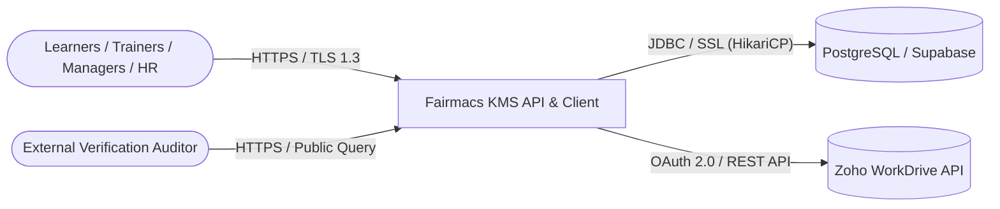
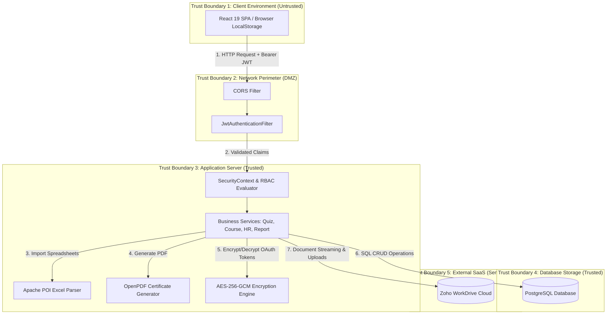

# Fairmacs KMS — Comprehensive Threat Model

**Document Reference:** TM-SEC-v1.0  
**Methodology:** STRIDE (per Element) & DREAD Risk Assessment  
**Target Architecture:** React 19 SPA, Spring Boot 3 REST API, PostgreSQL (Supabase), Zoho WorkDrive Cloud  
**Classification:** Confidential — Security Engineering Document

---

## 📑 Table of Contents
1. [Executive Summary & Scope](#1-executive-summary--scope)
2. [Architecture & Data Flow Diagrams (DFDs)](#2-architecture--data-flow-diagrams-dfds)
3. [Asset Inventory & Threat Actor Profiles](#3-asset-inventory--threat-actor-profiles)
4. [STRIDE Threat Decomposition](#4-stride-threat-decomposition)
   - [4.1 Spoofing Identity](#41-spoofing-identity)
   - [4.2 Tampering with Data](#42-tampering-with-data)
   - [4.3 Repudiation](#43-repudiation)
   - [4.4 Information Disclosure](#44-information-disclosure)
   - [4.5 Denial of Service](#45-denial-of-service)
   - [4.6 Elevation of Privilege](#46-elevation-of-privilege)
5. [DREAD Risk Assessment Matrix](#5-dread-risk-assessment-matrix)
6. [Mitigation & Countermeasure Implementation](#6-mitigation--countermeasure-implementation)
7. [Residual Risk & Continuous Monitoring](#7-residual-risk--continuous-monitoring)

---

## 1. Executive Summary & Scope

This Threat Model provides a rigorous evaluation of the security posture of **Fairmacs KMS**. The system automates corporate employee onboarding, course curriculum distribution, timed compliance quizzes, official certificate generation, and third-party cloud document synchronization.

The scope encompasses:
- The React single-page frontend running in user web browsers.
- The Spring Boot 3 API gateway, JWT authentication filters, and business service layer.
- Relational data persistence on PostgreSQL (hosted via Supabase).
- Cloud storage integration with Zoho WorkDrive via OAuth 2.0.
- High-volume document processors (OpenPDF certificate generator, Apache POI Excel batch importer).

---

## 2. Architecture & Data Flow Diagrams (DFDs)

### 2.1 Level 0 Context Diagram

### 2.2 Level 1 Data Flow Diagram & Trust Boundaries

---

## 3. Asset Inventory & Threat Actor Profiles

### 3.1 Critical Assets
| Asset ID | Description | Criticality |
|---|---|:---:|
| `A-01` | **JWT Secret Key (`JWT_SECRET`):** Signs and validates all authentication tokens. | **Critical** |
| `A-02` | **Zoho Token Encryption Key (`ZOHO_TOKEN_ENCRYPTION_KEY`):** Encrypts OAuth refresh tokens. | **Critical** |
| `A-03` | **Database Credentials (`SUPABASE_DB_PASSWORD`):** Grants access to PostgreSQL. | **Critical** |
| `A-04` | **Employee PII & Auth Credentials:** User passwords, email addresses, employee IDs. | **High** |
| `A-05` | **Certificate Verification Engine & Serial Numbers:** Official proof of compliance. | **High** |
| `A-06` | **Assessment Questions & Passing Logic:** Integrity of corporate examinations. | **High** |
| `A-07` | **Proprietary Course Documents:** Commercial freight guidelines in Zoho WorkDrive. | **Medium** |

### 3.2 Threat Actor Profiles
1. **Unauthenticated Internet Attacker:** Script kiddie or automated bot scanning for open endpoints, exposed `.env` files, or known Spring Boot CVEs.
2. **Malicious / Disgruntled Employee:** Authenticated learner attempting to forge test scores, bypass mandatory deadlines, or view peer transcripts.
3. **Privileged Insider (Trainer / Low-Level Manager):** Attempting vertical escalation into HR administrative operations.
4. **Third-Party File Sender:** Attacker uploading malformed `.xlsx` spreadsheets or corrupted PDFs designed to exhaust server heap or trigger parser exploits.

---

## 4. STRIDE Threat Decomposition

### 4.1 Spoofing Identity

| Threat ID | Threat Description | Vulnerable Component | Likelihood | Impact |
|---|---|---|:---:|:---:|
| `T-STRIDE-S1` | **JWT Signature Forgery:** Attacker guesses weak or default secret key and crafts unauthorized tokens with `ROLE_HR_ADMIN`. | `JwtTokenProvider` | Low | **Critical** |
| `T-STRIDE-S2` | **OAuth 2.0 State Tampering:** Attacker intercepts Zoho OAuth redirect and injects arbitrary authorization codes. | `ZohoOAuthController` | Low | **High** |
| `T-STRIDE-S3` | **Certificate Number Forgery:** Attacker crafts a fake certificate ID (e.g., `FM-CERT-9999`) to pass external audits. | `CertificateController` | Medium | **High** |

**Mitigations:**
- `T-STRIDE-S1`: Enforce minimum 256-bit entropy on `JWT_SECRET`; validate algorithm explicitly as `HS256`.
- `T-STRIDE-S2`: Generate cryptographically secure random `state` nonce stored in memory cache with 5-minute TTL; reject unverified callbacks.
- `T-STRIDE-S3`: Verify certificates strictly against primary database records; format uses strict sequential hashing.

---

### 4.2 Tampering with Data

| Threat ID | Threat Description | Vulnerable Component | Likelihood | Impact |
|---|---|---|:---:|:---:|
| `T-STRIDE-T1` | **Client-Side Quiz Score Manipulation:** Employee intercepts quiz submit payload and sends `score: 100`. | `QuizProgressController` | High | **High** |
| `T-STRIDE-T2` | **Lesson Progress Bypassing:** Employee script marks all lessons completed in milliseconds without viewing content. | `LessonProgressController` | Medium | **Medium** |
| `T-STRIDE-T3` | **SQL Injection in Department Filtering:** Attacker inputs SQL metacharacters (`' OR 1=1; --`) in filter parameters. | `DepartmentRepository` | Low | **Critical** |

**Mitigations:**
- `T-STRIDE-T1`: Server-authoritative design. The client sends *only* question answer selections (`answers: { "501": "B" }`). The server evaluates answers against the database and computes the final score.
- `T-STRIDE-T2`: Implement time-tracking validation; require minimum elapsed duration before quiz unlocking is permitted.
- `T-STRIDE-T3`: Spring Data JPA and Hibernate use parameterized prepared statements across all queries.

---

### 4.3 Repudiation

| Threat ID | Threat Description | Vulnerable Component | Likelihood | Impact |
|---|---|---|:---:|:---:|
| `T-STRIDE-R1` | **Disputing Mandatory Training Compliance:** Employee claims they completed a mandatory training before a deadline despite records showing overdue. | `EnrollmentService` | Medium | **Medium** |
| `T-STRIDE-R2` | **Disputing Quiz Attempts:** Learner claims the system submitted answers prematurely. | `QuizService` | Low | **Low** |
| `T-STRIDE-R3` | **Repudiating Corporate Policy Agreement:** Employee claims they never signed or acknowledged a critical corporate compliance policy or SOP. | `PolicyService` | Medium | **High** |

**Mitigations:**
- `T-STRIDE-R1`: Database stores immutable timestamps for `enrolled_at`, `completed_at`, and `last_activity_at`.
- `T-STRIDE-R2`: Every quiz attempt logs `started_at`, `submitted_at`, duration in seconds, IP context, and detailed answer mappings in `quiz_attempts`.
- `T-STRIDE-R3`: Policy acknowledgements record digital signature, client IP address, UTC timestamp, and policy version snapshot in immutable database records.

---

### 4.4 Information Disclosure

| Threat ID | Threat Description | Vulnerable Component | Likelihood | Impact |
|---|---|---|:---:|:---:|
| `T-STRIDE-I1` | **Zoho OAuth Refresh Token Exposure:** Attacker breaches database dump or reads plaintext refresh tokens. | `zoho_oauth_tokens` | Low | **Critical** |
| `T-STRIDE-I2` | **Leaking Quiz Question Answer Keys:** Question fetching endpoint includes `isCorrect: true` in the JSON response payload. | `QuizController` | High | **High** |
| `T-STRIDE-I3` | **Unfiltered Stack Traces:** Server 500 error outputs database credentials or SQL query fragments. | Global Exception Handler | Medium | **Medium** |
| `T-STRIDE-I4` | **Accidental Secret Commit to Git:** Developer commits `application.properties` with database passwords or API keys. | Git Repository | Medium | **Critical** |
| `T-STRIDE-I5` | **Confidential Document Exfiltration:** Employee downloads or screenshots proprietary course/policy PDFs and leaks them. | Document Streaming & Viewer | Medium | **High** |

**Mitigations:**
- `T-STRIDE-I1`: All Zoho refresh tokens are encrypted at rest using AES-256-GCM (`ZohoOAuthService`).
- `T-STRIDE-I2`: DTO mapper explicitly strips `isCorrect` fields when serving questions to learners.
- `T-STRIDE-I3`: Sanitize all error responses into RFC 7807 problem payloads without exposing internal exception classes.
- `T-STRIDE-I4`: Exclude `.env`, `*local.properties`, `backups/`, and `backend/uploads/` via `.gitignore`; use pure environment variables.
- `T-STRIDE-I5`: `PolicyWatermarkService` stamps an unalterable rotated diagonal watermark across every page with employee name, employee ID, and UTC timestamp, with strict mathematical non-clipping boundaries.

---

### 4.5 Denial of Service

| Threat ID | Threat Description | Vulnerable Component | Likelihood | Impact |
|---|---|---|:---:|:---:|
| `T-STRIDE-D1` | **Excel XML Entity Bomb (XXE / Zip-Bomb):** HR Admin uploads an Excel file with deeply nested XML or uncompressed multi-gigabyte payload. | `EmployeeExcelImportService` | Medium | **High** |
| `T-STRIDE-D2` | **Unbounded File Uploads:** Uploading gigabyte-sized files exhaust server disk space and RAM. | `ZohoWorkDriveTestController` | Medium | **High** |
| `T-STRIDE-D3` | **Memory Exhaustion on Large Report Exports:** Generating unpaginated 50,000-row Excel/PDF reports exhausts Java heap space. | `ReportsView` & Backend | Medium | **Medium** |

**Mitigations:**
- `T-STRIDE-D1`: Apache POI 5.4.1 disables external entity parsing by default; streaming parsers limit uncompressed byte limits.
- `T-STRIDE-D2`: Spring Boot enforces strict `10MB` limit on file size and total multipart request size.
- `T-STRIDE-D3`: Enforce database query pagination and streaming result sets.

---

### 4.6 Elevation of Privilege

| Threat ID | Threat Description | Vulnerable Component | Likelihood | Impact |
|---|---|---|:---:|:---:|
| `T-STRIDE-E1` | **Insecure Direct Object Reference (IDOR):** An employee calls `GET /api/reports/manager/employee/1/transcript` to view another employee's performance. | `ManagerReportController` | High | **High** |
| `T-STRIDE-E2` | **Horizontal Role Tampering:** User modifies client token payload in browser LocalStorage to set `role: "HR_ADMIN"`. | Frontend Client | High | **Zero** |
| `T-STRIDE-E3` | **Mass Assignment in Employee Creation:** User submits `"role": "HR_ADMIN"` during self-registration or profile update. | `HrAdminController` | Medium | **High** |
| `T-STRIDE-E4` | **Container Breakout & Privilege Escalation:** Attacker exploits application flaw to escape JVM and gain host root privileges. | Docker Container | Low | **Critical** |

**Mitigations:**
- `T-STRIDE-E1`: Enforce manager-to-employee relationship validation in `ManagerReportService` using `SecurityContextUtil.getCurrentUserId()`.
- `T-STRIDE-E2`: Frontend state is purely representational; all API requests are cryptographically validated by the Spring Security filter on the server.
- `T-STRIDE-E3`: Self-registration is disabled; user creation endpoints require `@PreAuthorize("hasRole('HR_ADMIN')")`.
- `T-STRIDE-E4`: Container runs strictly as unprivileged system user `app:app` (UID 1001) without root capabilities, bounded by `-XX:MaxRAMPercentage=70`.

---

## 5. DREAD Risk Assessment Matrix

Scoring Criteria: **D**amage, **R**eproducibility, **E**xploitability, **A**ffected Users, **D**iscoverability (Scale 1–10).

| Threat Ref | Threat Name | D | R | E | A | D | Total | Risk Level |
|---|---|:---:|:---:|:---:|:---:|:---:|:---:|:---:|
| `T-STRIDE-I4` | Credential commit in Git | 10 | 10 | 9 | 10 | 9 | **48/50** | **CRITICAL** |
| `T-STRIDE-S1` | JWT Secret Key Forgery | 10 | 8 | 5 | 10 | 6 | **39/50** | **HIGH** |
| `T-STRIDE-T1` | Client-side Quiz Score Tampering | 7 | 10 | 9 | 5 | 8 | **39/50** | **HIGH** |
| `T-STRIDE-E1` | IDOR on Employee Transcripts | 7 | 9 | 8 | 6 | 7 | **37/50** | **HIGH** |
| `T-STRIDE-I1` | Zoho OAuth Token Disclosure | 9 | 6 | 6 | 5 | 5 | **31/50** | **HIGH** |
| `T-STRIDE-D1` | Excel Zip-Bomb DoS | 8 | 7 | 6 | 4 | 5 | **30/50** | **MEDIUM** |
| `T-STRIDE-S3` | Certificate Number Forgery | 6 | 8 | 7 | 4 | 5 | **30/50** | **MEDIUM** |
| `T-STRIDE-T3` | SQL Injection via Search | 9 | 4 | 3 | 8 | 4 | **28/50** | **MEDIUM** |
| `T-STRIDE-R1` | Compliance Disputation | 4 | 6 | 5 | 3 | 4 | **22/50** | **LOW** |

---

## 6. Mitigation & Countermeasure Implementation

| Threat Reference | Implemented Countermeasure | Code / Config Location | Status |
|---|---|---|:---:|
| `T-STRIDE-I4` | Zero-credential policy, `.gitignore` excludes `.env`, `*local.properties`, `backups/`, `backend/uploads/` | [`.gitignore`](.gitignore) | **Verified** |
| `T-STRIDE-S1` | 256-bit minimum HMAC-SHA-256 validation via dynamic env var `JWT_SECRET` | [`JwtTokenProvider.java`](backend/src/main/java/com/fairmacs/lms/security/JwtTokenProvider.java) | **Verified** |
| `T-STRIDE-T1` | Server-authoritative quiz engine; scores computed strictly in backend | [`QuizService.java`](backend/src/main/java/com/fairmacs/lms/service/QuizService.java) | **Verified** |
| `T-STRIDE-I1` | AES-256-GCM encryption for Zoho OAuth tokens at rest | [`ZohoOAuthService.java`](backend/src/main/java/com/fairmacs/lms/integration/zoho/ZohoOAuthService.java) | **Verified** |
| `T-STRIDE-E1` | Method-level RBAC (`@PreAuthorize`) and direct-report ownership checks | [`SecurityConfig.java`](backend/src/main/java/com/fairmacs/lms/security/SecurityConfig.java) | **Verified** |
| `T-STRIDE-D2` | Multipart upload cap set to 10MB | [`application.properties`](backend/src/main/resources/application.properties) | **Verified** |
| `T-STRIDE-T3` | Parameterized SQL queries via Spring Data JPA repositories | Repositories Layer | **Verified** |
| `T-STRIDE-I5` | Dynamic rotated non-clipping watermark embedding employee ID & timestamp on PDF streams | [`PolicyWatermarkService.java`](backend/src/main/java/com/fairmacs/lms/service/PolicyWatermarkService.java) | **Verified** |
| `T-STRIDE-R3` | Immutable policy acknowledgement tracking capturing digital signature, IP address, and UTC timestamp | [`PolicyService.java`](backend/src/main/java/com/fairmacs/lms/service/PolicyService.java) | **Verified** |
| `T-STRIDE-E4` | Non-root container UID 1001 execution, restricted capabilities, and memory limits | [`Dockerfile`](backend/Dockerfile) | **Verified** |

---

## 7. Residual Risk & Continuous Monitoring

1. **Client-Side Token Storage in LocalStorage:**
   - *Risk:* In the event of an XSS vulnerability, tokens stored in `localStorage` could be exfiltrated.
   - *Planned Enhancement:* Transition JWT storage to `HttpOnly`, `SameSite=Strict`, `Secure` cookies with CSRF token protection in future revisions.
2. **Rate Limiting on Authentication Endpoints:**
   - *Planned Enhancement:* Integrate Bucket4j or Redis-backed distributed rate limiters on `/api/auth/login` to prevent distributed brute-force attacks.
3. **Automated Continuous Threat Modeling:**
   - Re-evaluate this model whenever new third-party integrations (e.g., HRMS, Single Sign-On / SAML 2.0) are introduced.
